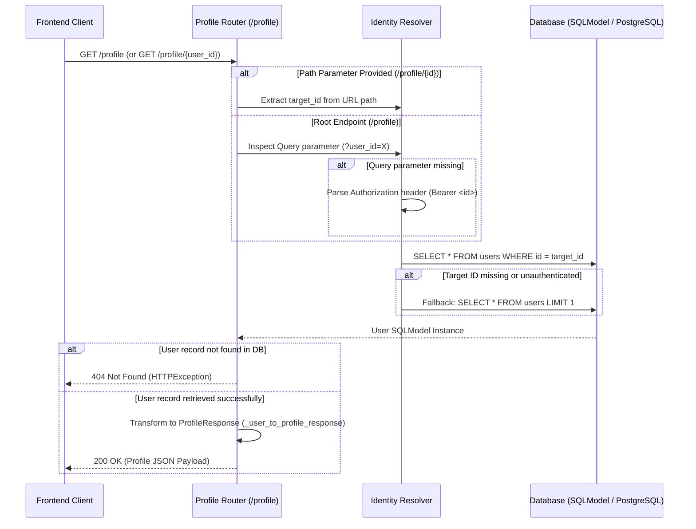

# Profile Router Documentation (`routes/profile.py`)

## High-Level Overview
The `profile.py` module defines RESTful endpoints under the `/profile` prefix for managing user profiles and synchronizing account metadata with the ArthaNetra AI frontend. It supports both root query-based (`GET /profile`, `PUT /profile`) and path-parameterized (`GET /profile/{user_id}`, `PUT /profile/{user_id}`) operations to accommodate various frontend state hydration and profile updating workflows.

When a user logs in and the app hydrates via [`AuthContext.jsx`](file:///home/abhijay/python/arthanetra/frontend/src/context/AuthContext.jsx), the frontend retrieves user metadata and default financial context (such as financial health score, persona, income type, and savings goals) from these endpoints.

---

## Interface Breakdown

### Data Models (Pydantic Schemas)

#### `ProfileResponse`
Represents the serialized output returned by profile retrieval and update endpoints.

| Field | Type | Required / Default | Description |
| :--- | :--- | :--- | :--- |
| `user_id` | `int` | Required | Primary key user identifier (aliased for frontend compatibility). |
| `id` | `int` | Required | Primary key user identifier. |
| `name` | `str` | Required | Full name of the authenticated user. |
| `mobile` | `str` | Required | 10-digit registered mobile contact number. |
| `email` | `Optional[str]` | `None` | Optional email address registered to the account. |
| `created_at` | `Optional[datetime]` | `None` | Account creation timestamp (ISO 8601 string when serialized). |
| `language` | `Optional[str]` | `"English"` | User's preferred conversational interface language. |
| `financial_health_score` | `Optional[int]` | `75` | Computed score (0–100) reflecting user financial health. |
| `persona` | `Optional[str]` | `"Standard User"` | Categorized user financial persona. |
| `income_type` | `Optional[str]` | `"Variable"` | User's primary income classification. |
| `goal` | `Optional[str]` | `"Budget Optimization"` | User's active financial planning target. |

#### `ProfileUpdateRequest`
Represents the request payload accepted by profile update endpoints (`PUT`).

| Field | Type | Required / Default | Description |
| :--- | :--- | :--- | :--- |
| `user_id` | `Optional[int]` | `None` | Optional target user ID when updating via body payload. |
| `id` | `Optional[int]` | `None` | Alias for `user_id` in request payloads. |
| `name` | `Optional[str]` | `None` | New display name to assign. |
| `mobile` | `Optional[str]` | `None` | New 10-digit mobile number (checked for uniqueness). |
| `password` | `Optional[str]` | `None` | Updated account password. |
| `email` | `Optional[str]` | `None` | Updated account email address. |
| `language` | `Optional[str]` | `None` | Updated preferred language. |
| `financial_health_score` | `Optional[int]` | `None` | Updated financial health metric. |
| `persona` | `Optional[str]` | `None` | Updated financial persona. |
| `income_type` | `Optional[str]` | `None` | Updated income classification. |
| `goal` | `Optional[str]` | `None` | Updated financial planning target. |

---

### Endpoints Specification

| HTTP Method | Route Subpath | Handler Function | Request Parameters / Body | Responses |
| :--- | :--- | :--- | :--- | :--- |
| `GET` | `/profile` (and `/profile/`) | `get_profile` | • **Query:** `user_id: Optional[int]`<br>• **Header:** `Authorization: Optional[str]` | • **`200 OK`:** Returns [`ProfileResponse`](file:///home/abhijay/python/arthanetra/Backend/routes/profile.py#L13-L24)<br>• **`404 Not Found`:** User not found |
| `GET` | `/profile/{user_id}` | `get_profile_by_id` | • **Path:** `user_id: int` | • **`200 OK`:** Returns [`ProfileResponse`](file:///home/abhijay/python/arthanetra/Backend/routes/profile.py#L13-L24)<br>• **`404 Not Found`:** User not found |
| `PUT` | `/profile` (and `/profile/`) | `update_profile` | • **Query:** `user_id: Optional[int]`<br>• **Header:** `Authorization: Optional[str]`<br>• **Body:** [`ProfileUpdateRequest`](file:///home/abhijay/python/arthanetra/Backend/routes/profile.py#L27-L38) | • **`200 OK`:** Returns updated [`ProfileResponse`](file:///home/abhijay/python/arthanetra/Backend/routes/profile.py#L13-L24)<br>• **`400 Bad Request`:** Duplicate mobile number<br>• **`404 Not Found`:** User not found<br>• **`500 Internal Error`:** DB mutation failure |
| `PUT` | `/profile/{user_id}` | `update_profile_by_id` | • **Path:** `user_id: int`<br>• **Body:** [`ProfileUpdateRequest`](file:///home/abhijay/python/arthanetra/Backend/routes/profile.py#L27-L38) | • **`200 OK`:** Returns updated [`ProfileResponse`](file:///home/abhijay/python/arthanetra/Backend/routes/profile.py#L13-L24)<br>• **`400 Bad Request`:** Duplicate mobile number<br>• **`404 Not Found`:** User not found<br>• **`500 Internal Error`:** DB mutation failure |

---

## Architecture & Flow

### Request Pipeline & Resolution Flow
The following sequence diagram demonstrates how profile requests resolve user identities across explicit path parameters, bearer headers, query parameters, or unauthenticated fallbacks during app hydration.



### Profile Update & Transaction Rollback Architecture
When modifying user profiles (`PUT`), database operations are guarded within atomic transaction boundaries to preserve data integrity:

```mermaid
flowchart TD
    Start([PUT /profile or PUT /profile/{id}]) --> Resolve[Resolve Target User Record]
    Resolve --> CheckExist{User Found?}
    CheckExist -- No --> Err404[Raise 404 Not Found]
    CheckExist -- Yes --> CheckMobile{Mobile Number Updated?}
    CheckMobile -- Yes --> QueryDup[Query DB for Duplicate Mobile]
    QueryDup --> IsDup{Duplicate Exists?}
    IsDup -- Yes --> Err400[Raise 400 Bad Request: Mobile Registered]
    CheckMobile -- No --> Apply[Apply Mutations to User Model]
    IsDup -- No --> Apply

    Apply --> TransStart[Start DB Mutation Try Block]
    TransStart --> DBAdd[db.add user & db.commit]
    DBAdd --> Success{Commit Successful?}
    Success -- Yes --> DBRef[db.refresh user]
    DBRef --> Ret200([Return 200 OK ProfileResponse])
    Success -- No / Exception --> Rollback[db.rollback]
    Rollback --> CheckHTTP{Is HTTPException?}
    CheckHTTP -- Yes --> ReRaise([Re-raise Existing HTTPException])
    CheckHTTP -- No --> Err500([Raise 500 Internal Server Error])
```

---

## Dependencies & Environment

| Dependency | Type | Purpose |
| :--- | :--- | :--- |
| `fastapi` | Framework | Provides routing (`APIRouter`), request parsing (`Query`, `Header`), and error raising (`HTTPException`, `Depends`). |
| `sqlmodel` | ORM / DB | Provides session management (`Session`) and SQL query building (`select`). |
| `pydantic` | Data Validation | Defines input (`ProfileUpdateRequest`) and output (`ProfileResponse`) validation schemas (`BaseModel`, `Field`). |
| [`dbmodel.Database`](file:///home/abhijay/python/arthanetra/Backend/dbmodel/Database.py) | Internal Module | Dependency injector providing generator sessions via `get_db`. |
| [`dbmodel.models.User`](file:///home/abhijay/python/arthanetra/Backend/dbmodel/models.py) | Internal Module | SQLModel table representing persistent user account records in the PostgreSQL/SQLite database. |

---

## Security & Limitations

1. **Transaction Integrity & Explicit Rollbacks:**
   All update operations wrap `db.add()`, `db.commit()`, and `db.refresh()` in robust `try...except` blocks. If an unexpected database fault occurs (e.g. unique constraint violation at DB level), `db.rollback()` executes before re-raising an HTTP exception to ensure database connections are never left hanging in an uncommitted state.

2. **Duplicate Contact Protection:**
   When updating a user's mobile contact number, the handler queries existing records (`select(User).where(User.mobile == payload.mobile)`). If another account claims that number, a `400 Bad Request` is returned to prevent collision.

3. **Fallback Resolution for Demo Hydration:**
   If root `/profile` requests omit query identifiers and authorization headers (common during early demo or initial unauthenticated frontend hydration), the handler queries the first user in the database (`select(User).first()`). While ideal for frictionless demos and preventing UI crashes, production deployments should replace this fallback with strict JWT token decoding and `401 Unauthorized` enforcement.
