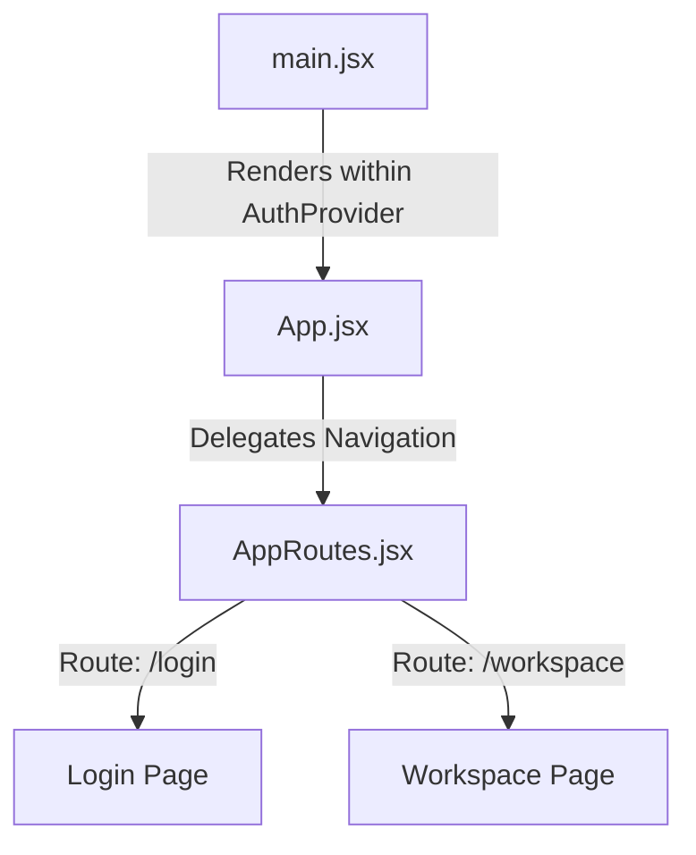

# App.jsx Documentation

## High-Level Overview
`App.jsx` serves as the primary root React component for the ArthaNetra AI frontend application. Its core purpose is to encapsulate and render the application's top-level navigation structure by embedding the `AppRoutes` component. As a structural bridge between the entry point (`main.jsx`) and routing logic (`AppRoutes.jsx`), it provides a clean hierarchy for global application composition.

## Interface Breakdown

| Component / Function | Type | Props / Parameters | Return Type | Description |
| :--- | :--- | :--- | :--- | :--- |
| `App` | Functional React Component | None | `JSX.Element` | Renders the top-level `<AppRoutes />` component responsible for application routing. |

## Architecture & Flow

## Dependencies & Environment

| Dependency | Type | Purpose |
| :--- | :--- | :--- |
| `./routes/AppRoutes` | Internal Module | Imports the router configuration and view dispatch logic. |
| `react` | External Package | Implicitly required by JSX transpilation in React 18+. |

## Security & Limitations
- **State Isolation:** `App.jsx` currently holds no global state or layout wrapper (e.g., headers or footers). Any global layout shifts must either be added here or within individual route components.
- **Error Handling:** Does not implement a React Error Boundary (`<ErrorBoundary>`). If a routing error or unhandled render exception occurs in `<AppRoutes />`, the entire component tree may crash ungracefully.
