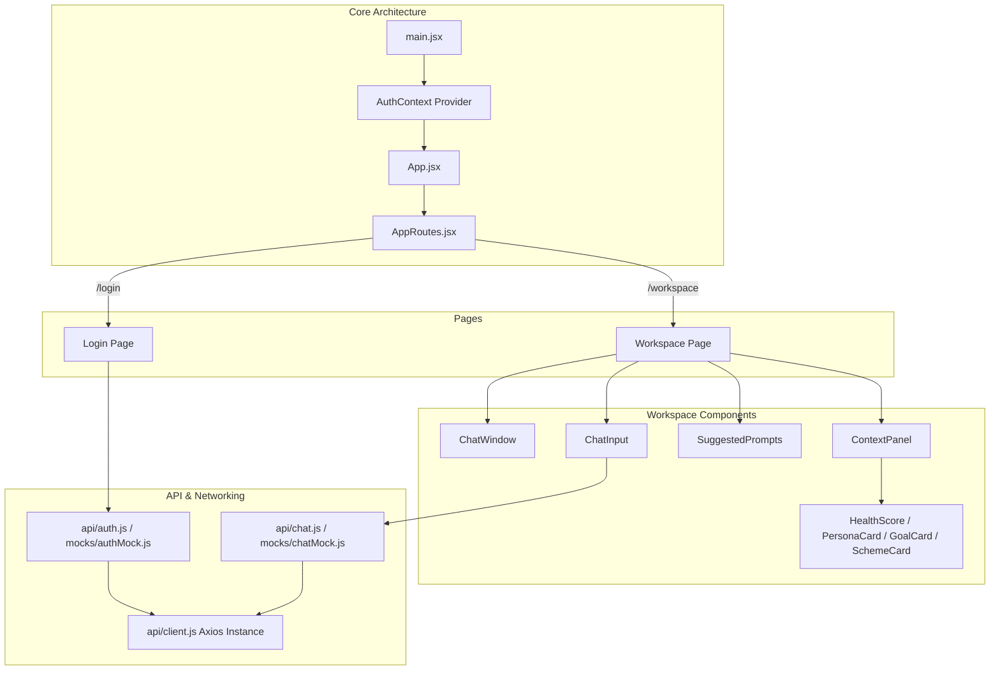

# ArthaNetra AI — Frontend Technical Documentation

Welcome to the centralized technical documentation for the **ArthaNetra AI Frontend**, an advanced, multilingual AI-powered financial intelligence web application built with **React 19**, **Vite**, and **Tailwind CSS**.

This documentation was generated following the strict architecture and structure defined in `document-maker.md`. Each module and component is thoroughly documented with:
- **High-Level Overview:** Business logic and core purpose within ArthaNetra AI.
- **Interface Breakdown:** Explicit tables of parameters, props, endpoints, and return types.
- **Architecture & Flow:** Embedded Mermaid.js diagrams illustrating data pipelines and rendering trees.
- **Dependencies & Environment:** Package relationships and API dependencies.
- **Security & Limitations:** Known edge cases, authentication boundaries, and runtime performance notes.

---

## Centralized Table of Contents

### 1. Application Core
The root entry points and bootstrapping configuration for the React application.
- [App Component](./App.md) — Root component wrapping the routing structure.
- [Main Entry Point](./main.md) — React DOM hydration and context provider setup.

### 2. Routing Structure
Declarative application navigation and route definitions.
- [AppRoutes](./routes/AppRoutes.md) — Multi-page router configuration (`/login`, `/workspace`, default redirects).

### 3. Application Pages
Top-level page views managing complete UI layouts and screen states.
- [Login Page](./pages/Login.md) — Multilingual onboarding and authentication portal with animated glassmorphic aesthetics.
- [AI Workspace Page](./pages/Workspace.md) — Primary interactive financial advisory dashboard, prompt console, and analytics panel.

### 4. Global Context & State Management
Application-wide React Context providers managing authentication and session lifecycle.
- [AuthContext](./context/AuthContext.md) — User authentication state, login/logout actions, and session context provider.

### 5. API & Networking Layer
Hybrid WebSocket streaming clients and HTTP endpoint service wrappers for real-time AI backend interaction.
- [API Client](./api/client.md) — Singleton Axios HTTP client configured with dynamic base URLs and JWT request interceptors.
- [Auth API](./api/auth.md) — Authentication endpoints (`login`, `register`, `checkRegistration`).
- [Chat API](./api/chat.md) — Real-time persistent **WebSocket connection (`ChatWebSocketService`)** with automatic reconnection, event-driven telemetry stream handling, and HTTP POST fallback.
- [Profile API](./api/profile.md) — Authenticated user profile fetching and user state synchronization.

### 6. Development & Offline Mocks
Simulated network layers for standalone frontend execution and UI testing.
- [Auth Mock Service](./mocks/authMock.md) — Simulated authentication verification with synthetic latency.
- [Chat Mock Service](./mocks/chatMock.md) — Keyword-driven AI financial companion simulation returning localized context payloads.

### 7. UI Components

#### Authentication Components (`components/auth`)
- [AuthTabs](./components/auth/AuthTabs.md) — Tabbed navigation switcher between user login and account registration.
- [LoginForm](./components/auth/LoginForm.md) — Secure login form with validation, OTP toggle, and multilingual feedback.
- [RegisterForm](./components/auth/RegisterForm.md) — Multi-field registration form for onboarding new financial users.

#### AI Chat Console Components (`components/chat`)
- [ChatWindow](./components/chat/ChatWindow.md) — Scrollable conversational feed rendering message bubbles and loading indicators.
- [ChatMessage](./components/chat/ChatMessage.md) — Individual message bubble with Markdown support, sender styling, and timestamps.
- [ChatInput](./components/chat/ChatInput.md) — Multi-line prompt text box featuring voice recording toggle and submission controls.
- [SuggestedPrompts](./components/chat/SuggestedPrompts.md) — Quick-start financial inquiry cards for rapid exploration.
- [TypingIndicator](./components/chat/TypingIndicator.md) — Animated visual feedback indicating real-time AI inference.
- [VoiceButton](./components/chat/VoiceButton.md) — Microphone action button for speech-to-text input simulation.
- [LanguageSelector](./components/chat/LanguageSelector.md) — Dropdown menu for real-time localization switching across Indian and global languages.

#### Context & Financial Analytics Components (`components/context`)
- [ContextPanel](./components/context/ContextPanel.md) — Live sidebar displaying user health scores, active personas, and financial goals.
- [HealthScore](./components/context/HealthScore.md) — Visual circular gauge displaying the user's computed financial health (0–100).
- [PersonaCard](./components/context/PersonaCard.md) — Profile card displaying user demographic and income categorization.
- [GoalCard](./components/context/GoalCard.md) — Active financial target tracking widget.
- [SchemeCard](./components/context/SchemeCard.md) — Government financial welfare scheme recommendations matching user eligibility.

#### Shared Design System Components (`components/shared`)
- [Button](./components/shared/Button.md) — Polymorphic UI button supporting primary, secondary, and outline styles with loading states.
- [Card](./components/shared/Card.md) — Glassmorphic surface container with border glow and backdrop blur.
- [Input](./components/shared/Input.md) — Styled form input field with icon support, focus rings, and error message rendering.
- [Loader](./components/shared/Loader.md) — Animated SVG spinner for asynchronous state feedback.
- [Logo](./components/shared/Logo.md) — Brand visual identity component with vector iconography and gradient text clipping.

---

## Architectural Overview Diagram

