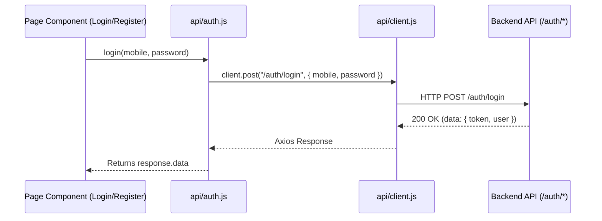

# auth.js Documentation

## High-Level Overview
`auth.js` serves as the frontend asynchronous API service layer responsible for communicating with backend authentication endpoints. It abstracts REST HTTP interactions (`POST /auth/login`, `GET /auth/register`, and `POST /auth/register`) utilizing the preconfigured Axios instance (`client`). It encapsulates request body formatting, parameter normalization (such as fallback name/email handling), and standardized exception unwrapping.

## Interface Breakdown

| Function | Type | Parameters | Return Type | Description |
| :--- | :--- | :--- | :--- | :--- |
| `login` | Async Function | `mobile: string`, `password: string` | `Promise<Object>` | Authenticates credentials and returns JWT token and user details. |
| `checkRegistration` | Async Function | `mobile: string` | `Promise<Object>` | Verifies whether a mobile number is already registered in the system. |
| `register` | Async Function | `mobile: string`, `password: string`, `name?: string`, `email?: string` | `Promise<Object>` | Registers a new user account with normalized fallback handling. |

### Function Details & Parameters

#### `login(mobile, password)`
- **Request Payload:** `{ mobile, password }`
- **Throws:** `Error` containing backend API error details or `"Login failed. Please try again."`.

#### `checkRegistration(mobile)`
- **Request Query Params:** `?mobile=<mobile>`
- **Throws:** `Error` containing `"Failed to check registration status."` upon failure.

#### `register(mobile, password, name = "User", email = null)`
- **Logic:** If `name` contains an `@` symbol and `email` is null, `name` is automatically assigned to `email` and `name` defaults to `"User"`.
- **Request Payload:** `{ mobile, password, name, ...(email && { email }) }`

## Architecture & Flow

## Dependencies & Environment

| Dependency | Type | Purpose |
| :--- | :--- | :--- |
| `./client` | Internal Module | Axios HTTP client configured with base URL and interceptors. |

## Security & Limitations
- **Plaintext Argument Handling:** Functions accept sensitive credentials (`password`) in plaintext memory before JSON serialization over HTTP/HTTPS.
- **Error Extraction Assumptions:** Assumes structured error payloads follow FastAPI conventions (`error.response?.data?.detail`) or generic formats (`error.response?.data?.message`). Unhandled HTML 500 error responses may result in opaque error strings.
