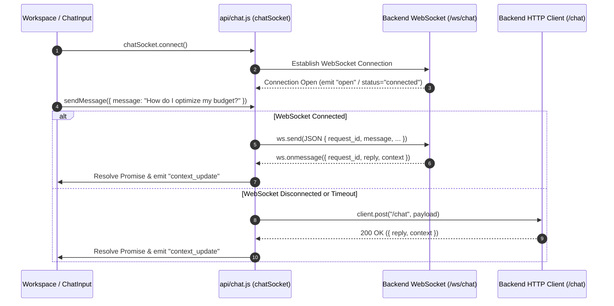

# chat.js Documentation

## High-Level Overview
`chat.js` (`frontend/src/api/chat.js`) provides the client-side communication layer for sending user prompts and receiving real-time AI financial advice and telemetry updates. It implements a persistent **WebSocket connection (`ChatWebSocketService`)** with an automatic **HTTP POST fallback**, ensuring resilience and continuous operation across different network environments.

When the application initializes, `chatSocket` connects to the real-time WebSocket endpoint (`ws://.../ws/chat`). It provides event-driven subscriptions (`on`, `off`, `emit`) for connection status transitions (`status_change`), incoming messages (`message`), and real-time context assessments (`context_update`). If WebSocket connectivity is unavailable or a request times out, `sendMessage` automatically routes payloads via secure HTTP POST (`/chat`), guaranteeing zero downtime.

## Interface Breakdown

### Exported Functions & Instances

| Export | Type | Parameters | Return Type | Description |
| :--- | :--- | :--- | :--- | :--- |
| `chatSocket` | `ChatWebSocketService` Singleton | N/A | Instance | Singleton instance managing persistent WebSocket connection, listeners, and reconnection lifecycle. |
| `sendMessage` | Async Function | `payload: Object \| string` | `Promise<Object>` | Dispatches chat payload via WebSocket (with request correlation) or falls back to HTTP POST `/chat`. |

### Endpoint & Protocol Specifications

#### WebSocket Stream (`chatSocket`)
- **Protocol & Path:** `ws://{host}/ws/chat` or `wss://{host}/ws/chat` (derived from `VITE_WS_URL` or converted from `VITE_API_URL`).
- **Outbound Request Schema:**
  ```json
  {
    "request_id": "req_1720000000000_abc12",
    "message": "Check eligible loans for me",
    "user_id": 1,
    "conversation_id": "demo-user",
    "language": "English"
  }
  ```
- **Inbound Event Schema:** Emits parsed JSON payloads. If the payload contains a `context` object, emits a `"context_update"` event.

#### HTTP POST Fallback
- **HTTP Method & Path:** `POST /chat`
- **Request Body:** `{ message, user_id, conversation_id, language }`

## Architecture & Flow



## Dependencies & Environment

| Dependency | Type | Purpose |
| :--- | :--- | :--- |
| `./client` | Internal Module | Axios HTTP client configured with base URL and authorization headers for HTTP fallback. |
| `VITE_WS_URL` | Environment Variable | Optional explicit WebSocket server URL override. |
| `VITE_API_URL` | Environment Variable | Base API URL used for constructing WebSocket target URL when `VITE_WS_URL` is omitted. |

## Security & Reliability Features

- **Automatic Exponential Backoff:** On disconnection or socket error, `chatSocket` attempts reconnection with exponentially increasing retry delays (up to 5 attempts, capped at 10 seconds).
- **Request ID Correlation:** Outbound requests tag payloads with a unique `request_id`, enabling robust asynchronous matching when messages stream back out of order.
- **Graceful Degradation:** UI callers do not need to differentiate between WebSocket stream and HTTP request protocols; `sendMessage` handles transport switching automatically.
