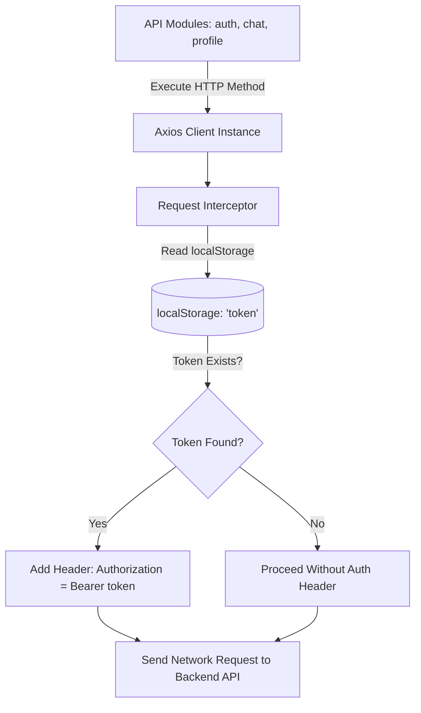

# client.js Documentation

## High-Level Overview
`client.js` defines and exports the singleton Axios HTTP client instance utilized across the entire ArthaNetra AI frontend. It sets foundational network defaults including the backend base URL and request timeout. Crucially, it attaches an Axios request interceptor that dynamically injects authentication JWT tokens stored in browser `localStorage` into the `Authorization` HTTP header for every outgoing HTTP request.

## Interface Breakdown

| Object / Instance | Type | Configuration | Description |
| :--- | :--- | :--- | :--- |
| `client` | `AxiosInstance` | Base URL, Headers, Timeout (10,000ms) | Central HTTP communication client for all API interactions. |

### Configuration Properties

| Property | Value / Fallback | Description |
| :--- | :--- | :--- |
| `baseURL` | `import.meta.env.VITE_API_URL` \|\| `"http://127.0.0.1:8000"` | Resolves API host from Vite environment variables or defaults to local loopback server. |
| `headers` | `{ "Content-Type": "application/json" }` | Establishes JSON as standard content encoding. |
| `timeout` | `10000` (ms) | Aborts outgoing HTTP requests that exceed 10 seconds without a response. |

### Interceptors

| Type | Target | Description |
| :--- | :--- | :--- |
| Request Interceptor | `client.interceptors.request` | Checks `localStorage.getItem("token")` prior to sending requests and prefixes it as `Bearer <token>`. |

## Architecture & Flow

## Dependencies & Environment

| Dependency | Type | Purpose |
| :--- | :--- | :--- |
| `axios` | External Package | Core HTTP client library providing instance configuration and interceptor pipelines. |
| `import.meta.env.VITE_API_URL` | Environment Variable | Configures environment-specific target API endpoint URLs. |

## Security & Limitations
- **Token Vulnerability in LocalStorage:** Storing JWT authentication tokens inside standard browser `localStorage` leaves credentials susceptible to Cross-Site Scripting (XSS) attacks.
- **Missing Response Interceptor:** Does not implement a response interceptor to handle global HTTP errors (e.g., intercepting HTTP 401 Unauthorized errors to trigger automatic user logout or session expiration cleanup).
