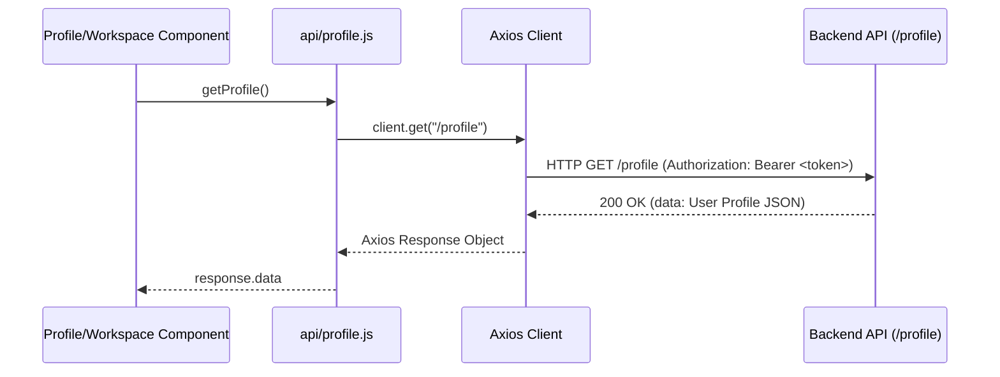

# profile.js Documentation

## High-Level Overview
`profile.js` serves as a dedicated API service module within the ArthaNetra AI frontend for retrieving user profile data from the server. It exports a single asynchronous function (`getProfile`) that initiates an HTTP GET request against the `/profile` API route, returning the authenticated user's account details and preferences.

## Interface Breakdown

| Function | Type | Parameters | Return Type | Description |
| :--- | :--- | :--- | :--- | :--- |
| `getProfile` | Async Function | None | `Promise<Object>` | Fetches user profile payload from `/profile` endpoint. |

### Endpoint Details
- **HTTP Method & Path:** `GET /profile`
- **Authentication Required:** Yes (handled implicitly by `client.js` request interceptor attaching `Bearer` token).
- **Expected Return:** Promise resolving to API JSON payload representing profile metadata.

## Architecture & Flow

## Dependencies & Environment

| Dependency | Type | Purpose |
| :--- | :--- | :--- |
| `./client` | Internal Module | Axios HTTP client configured with base endpoint and token injection. |

## Security & Limitations
- **Unhandled Exceptions:** Lacks local error wrapping (`try...catch`). Errors thrown by network failure, missing tokens (401 Unauthorized), or server faults propagate directly to the caller.
- **Cache-Control Absence:** Does not perform client-side profile caching or memoization; multiple successive component renders calling `getProfile()` will execute duplicate network calls.
