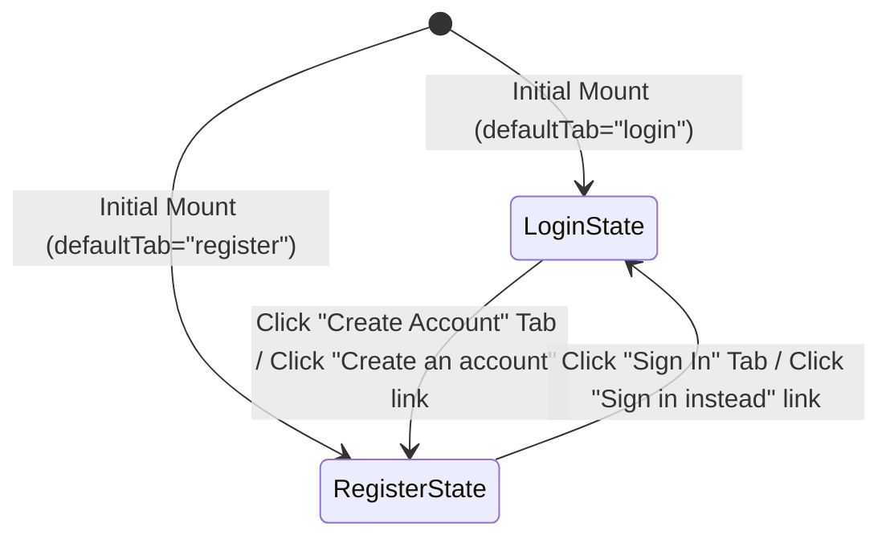

# AuthTabs Component Documentation

## High-Level Overview

The `AuthTabs` component (`AuthTabs.jsx`) serves as the primary container and navigation wrapper for authentication workflows in the ArthaNetra AI frontend application. Its core business purpose is to provide users with a seamless, sleek interface to switch between signing in to an existing account and registering a new account.

Within the ArthaNetra AI application architecture, `AuthTabs` acts as a stateful controller for the authentication interface. It maintains the current active tab (`login` or `register`) and dynamically renders either the `LoginForm` or `RegisterForm` component accordingly. Additionally, it passes callback props (`onSwitchToRegister` and `onSwitchToLogin`) down to child form components so that users can switch tabs directly via links embedded within the forms themselves.

## Interface Breakdown

### Component Props

| Prop Name | Type | Required | Default Value | Description |
| :--- | :--- | :--- | :--- | :--- |
| `defaultTab` | `string` | No | `"login"` | Determines the initial authentication form to display upon component mount. Valid values are `"login"` or `"register"`. |

### Internal State

| State Variable | Type | Initial Value | Description |
| :--- | :--- | :--- | :--- |
| `activeTab` | `string` | `defaultTab` (`"login"`) | Tracks currently active authentication tab (`"login"` or `"register"`). Controls both tab switcher styling and conditional rendering of child form components. |

### Child Component Callbacks

| Child Component | Callback Prop | Arguments | Description |
| :--- | :--- | :--- | :--- |
| `LoginForm` | `onSwitchToRegister` | None | Function triggered when the user clicks "Create an account" inside `LoginForm`. Sets `activeTab` state to `"register"`. |
| `RegisterForm` | `onSwitchToLogin` | None | Function triggered when the user clicks "Sign in instead" inside `RegisterForm`. Sets `activeTab` state to `"login"`. |

## Architecture & Flow

### Component Hierarchy & Interaction Flow

```mermaid
graph TD
    A[AuthTabs Component] -->|Renders Tab Switcher| B[Tab Switcher Header]
    B -->|Click 'Sign In'| C[setActiveTab('login')]
    B -->|Click 'Create Account'| D[setActiveTab('register')]
    
    A -->|Conditional Render based on activeTab| E{activeTab === 'login'?}
    
    E -->|Yes| F[LoginForm]
    E -->|No| G[RegisterForm]
    
    F -->|onSwitchToRegister callback| D
    G -->|onSwitchToLogin callback| C
```

### State Transition Diagram



## Dependencies & Environment

### External Packages & Modules

| Package / Module | Version / Source | Purpose |
| :--- | :--- | :--- |
| `react` | Core Dependency | Imports the `useState` hook for internal active tab state management. |
| `./LoginForm` | Local Component | Rendered when `activeTab` equals `"login"`. Handles user authentication submissions. |
| `./RegisterForm` | Local Component | Rendered when `activeTab` equals `"register"`. Handles new account creation and mobile validation. |

### Environment Variables

The `AuthTabs` component does not directly access `process.env` or `import.meta.env` environment variables. However, its child components (`LoginForm` and `RegisterForm`) rely on API client configurations that interact with backend authentication services.

## Security & Limitations

### Security Considerations

- **Client-Side State Isolation**: The switching mechanism is purely client-side state transitions. Sensitive authentication logic, rate limiting, and password verification are handled inside the child components (`LoginForm` and `RegisterForm`) via backend API calls.
- **No Prop Validation Libraries**: Currently uses standard JavaScript default parameters without TypeScript definitions or `propTypes` validation. Passing unexpected strings to `defaultTab` other than `"login"` or `"register"` will result in rendering the `RegisterForm` fallback branch without tab active styling for `"login"`.

### Limitations & Potential Improvements

- **URL Synchronization**: The component maintains tab selection solely in React local state (`useState`). Refreshing the browser page resets the view back to `defaultTab`. For enhanced UX, tab state could be synchronized with URL search parameters (e.g., `?tab=register`) or React Router nested routes (`/auth/login` and `/auth/register`).
- **Animation Transitions**: While button scaling and shadow transitions utilize Tailwind CSS utility classes (`transition-all duration-300`), switching between the login and register forms occurs instantaneously without mount/unmount animations or height smoothing transitions.
