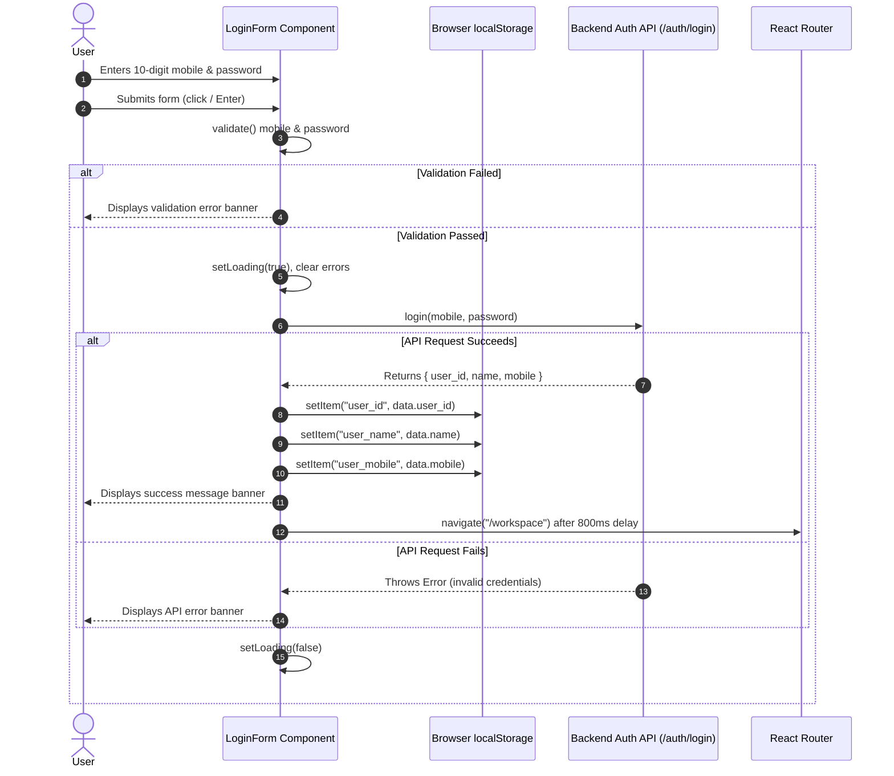
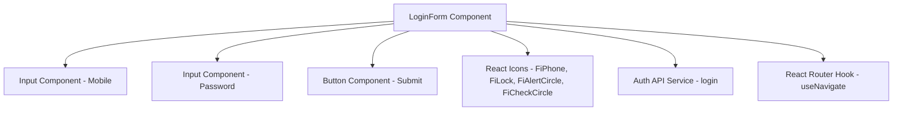

# LoginForm Component Documentation

## High-Level Overview

The `LoginForm` component (`LoginForm.jsx`) implements the secure user authentication interface for the ArthaNetra AI web application. Its primary business purpose is to authenticate existing users using their 10-digit mobile number and password, establish local user session credentials, and transition users into the main application workspace.

Within the frontend architecture, `LoginForm` operates as a controlled form component embedded inside `AuthTabs`. It manages client-side form state, input sanitization (ensuring numeric-only mobile numbers), local validation, API error handling, and visual feedback (loading spinners, success alerts, and error banners). Upon successful authentication via backend API integration, it persists user session data in browser local storage and triggers client-side navigation.

## Interface Breakdown

### Component Props

| Prop Name | Type | Required | Default Value | Description |
| :--- | :--- | :--- | :--- | :--- |
| `onSwitchToRegister` | `Function` | Yes | `undefined` | Callback function passed down from `AuthTabs` invoked when the user clicks the "Create an account" link. Switches the active authentication view to the registration form. |

### Internal State Variables

| State Variable | Type | Initial Value | Description |
| :--- | :--- | :--- | :--- |
| `mobile` | `string` | `""` | Holds the user's 10-digit mobile phone number. Automatically stripped of non-numeric characters on input. |
| `password` | `string` | `""` | Holds the user's login password input. |
| `loading` | `boolean` | `false` | Indicates whether an authentication request (`login` API call) is currently in progress. Disables form inputs and displays button loading spinner. |
| `error` | `string` | `""` | Stores client-side validation errors or server-side authentication failure messages to render in the rose alert banner. |
| `successMsg` | `string` | `""` | Stores positive confirmation message displayed in the emerald alert banner before redirecting to the workspace. |

### API Interactions & Storage Endpoints

| Function / Action | Target | Parameters | Return / Effect |
| :--- | :--- | :--- | :--- |
| `login(mobile, password)` | API Client (`../../api/auth`) | `mobile: string`, `password: string` | Returns user data object (`{ user_id, name, mobile }`) or throws an Error. |
| `localStorage.setItem` | Browser Storage | Keys: `"user_id"`, `"user_name"`, `"user_mobile"` | Persists authenticated session details for client-side state across page reloads. |
| `navigate("/workspace")` | React Router | Route path: `"/workspace"` | Programmatically transitions the user to the application workspace 800ms after login success. |

## Architecture & Flow

### Authentication Pipeline Diagram

### Component Dependency Structure

## Dependencies & Environment

### External Packages & Libraries

| Package / Module | Source / Path | Purpose |
| :--- | :--- | :--- |
| `react` | NPM (`react`) | Provides `useState` hook for managing controlled form state and UI flags. |
| `react-router-dom` | NPM (`react-router-dom`) | Provides `useNavigate` hook for SPA routing to `/workspace`. |
| `react-icons/fi` | NPM (`react-icons`) | Feather icons (`FiPhone`, `FiLock`, `FiAlertCircle`, `FiCheckCircle`) for inputs and alert banners. |
| `../../api/auth` | Internal Module | Encapsulates HTTP client interactions with the ArthaNetra backend authentication endpoint. |
| `../shared/Input` | Internal Component | Reusable styled form input field supporting icons, error formatting, and character limits. |
| `../shared/Button` | Internal Component | Reusable styled button with built-in loading spinner (`isLoading` prop) support. |

### Environment Variables & Storage

While `LoginForm` does not directly read environment variables, the imported `login` service expects the backend API base URL (e.g., `VITE_API_BASE_URL` or equivalent configured in Axios/Fetch client). The component requires read/write access to the browser's `window.localStorage` API to store session tokens and user attributes.

## Security & Limitations

### Security Rules & Protections

- **Input Filtering**: The mobile input field enforces strict regex filtering (`e.target.value.replace(/\D/g, "")`) and a hard character limit (`maxLength={10}`), mitigating injection risks and accidental alphabetic input.
- **Credential Masking**: Password input uses `type="password"` to prevent shoulder surfing.
- **Disabled State During In-Flight Requests**: All form inputs and the submit button are disabled (`disabled={loading}`) while an API request is processing, preventing duplicate submissions and race conditions.

### Known Limitations & Edge Cases

- **Local Storage Token Security**: User identity attributes (`user_id`, `user_name`, `user_mobile`) are stored in plain text inside `localStorage`. While standard for basic SPA session checks, sensitive authentication JWT tokens (if returned by backend) should ideally be stored in `HttpOnly` secure cookies to prevent XSS vulnerability exploitation.
- **Unhandled Storage Quota Exceptions**: In rare environments where `localStorage` is disabled (e.g., Safari Private Browsing strict mode or iframe sandbox restrictions), calling `localStorage.setItem` may throw an unhandled `DOMException`, blocking the redirect timeout. Wrapping storage calls in a `try/catch` block would enhance resilience.
- **Hardcoded Redirect Delay**: Navigation relies on a fixed `setTimeout(..., 800)`. If a component unmounts during this 800ms window (e.g., user navigates away manually), state updates or navigation might occur on an unmounted context.
