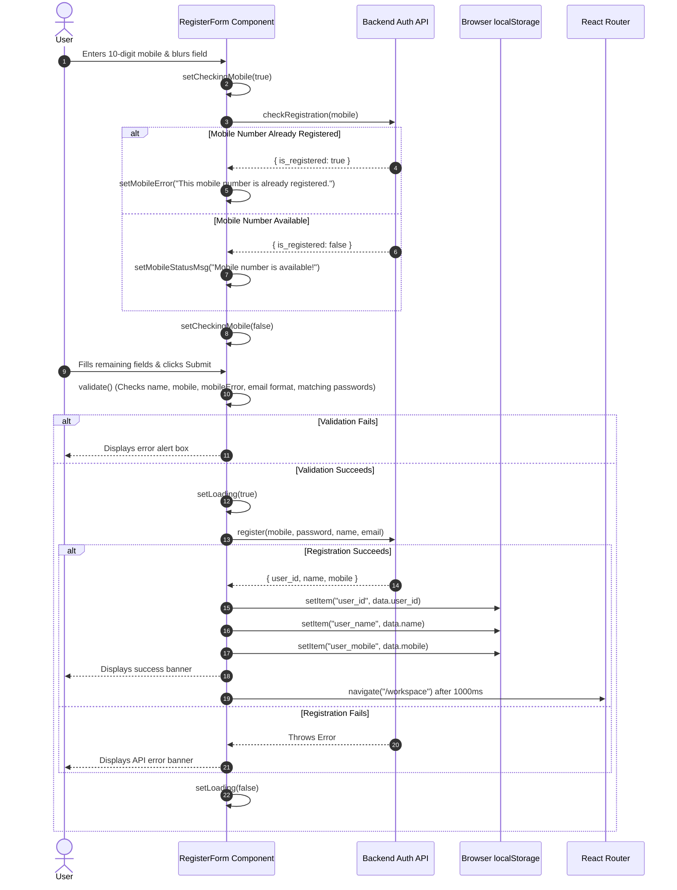
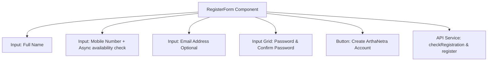

# RegisterForm Component Documentation

## High-Level Overview

The `RegisterForm` component (`RegisterForm.jsx`) provides the user onboarding and account registration interface for the ArthaNetra AI application. Its core business purpose is to capture new user profile information (full name, 10-digit mobile number, optional email address, and password), verify mobile number availability in real time, and provision a new user account on the ArthaNetra platform.

Within the application architecture, `RegisterForm` acts as a feature-rich controlled form inside the `AuthTabs` container. It incorporates proactive asynchronous validation—checking backend registration status upon mobile number field blur—to deliver immediate feedback before final form submission. Upon successful account creation via the backend registration API, the component initializes local user session variables in browser storage and seamlessly routes the user to the application workspace.

## Interface Breakdown

### Component Props

| Prop Name | Type | Required | Default Value | Description |
| :--- | :--- | :--- | :--- | :--- |
| `onSwitchToLogin` | `Function` | Yes | `undefined` | Callback function passed down from `AuthTabs` invoked when the user clicks the "Sign in instead" link. Switches active view to `LoginForm`. |

### Internal State Variables

| State Variable | Type | Initial Value | Description |
| :--- | :--- | :--- | :--- |
| `name` | `string` | `""` | User's full name input. Trimmed before validation and submission. |
| `mobile` | `string` | `""` | User's 10-digit mobile number. Non-numeric inputs are stripped automatically. |
| `email` | `string` | `""` | Optional user email address validated via regex if provided. |
| `password` | `string` | `""` | Primary account password input (minimum 4 characters required). |
| `confirmPassword` | `string` | `""` | Secondary password verification field to ensure matching input. |
| `loading` | `boolean` | `false` | Indicates whether final registration API submission is in progress. |
| `checkingMobile` | `boolean` | `false` | Indicates whether asynchronous mobile availability check (`checkRegistration`) is executing during field blur. |
| `mobileStatusMsg` | `string` | `""` | Success helper text displayed below mobile field when number is verified available. |
| `mobileError` | `string` | `""` | Error message displayed when `checkRegistration` confirms mobile number is already taken. Blocks submission. |
| `error` | `string` | `""` | Global form validation error or API submission failure banner text. |
| `successMsg` | `string` | `""` | Global success banner confirmation text displayed before workspace redirect. |

### API Endpoints & Functions

| Function / Method | Target Service | Parameters | Return / Behavior |
| :--- | :--- | :--- | :--- |
| `checkRegistration(mobile)` | Auth API (`../../api/auth`) | `mobile: string` | Returns `{ is_registered: boolean }` to verify existing account status during input blur. |
| `register(...)` | Auth API (`../../api/auth`) | `mobile`, `password`, `name`, `email` (`null` if empty) | Provisions account and returns user payload `{ user_id, name, mobile }`. |

## Architecture & Flow

### Registration Workflow & Asynchronous Blur Verification

### Component Structure & Child Integrations

## Dependencies & Environment

### External Packages & Libraries

| Package / Module | Source / Path | Purpose |
| :--- | :--- | :--- |
| `react` | NPM (`react`) | Provides `useState` hook for managing multi-field form data and UI states. |
| `react-router-dom` | NPM (`react-router-dom`) | Provides `useNavigate` hook for programmatic post-registration redirection. |
| `react-icons/fi` | NPM (`react-icons`) | Feather UI icons (`FiUser`, `FiPhone`, `FiLock`, `FiMail`, `FiAlertCircle`, `FiCheckCircle`). |
| `../../api/auth` | Internal Module | Connects to ArthaNetra authentication endpoints (`checkRegistration` and `register`). |
| `../shared/Input` | Internal Component | Form input component supporting dynamic helper texts, loading indicators, and field errors. |
| `../shared/Button` | Internal Component | Primary action button with loading spinner integration. |

### Environment Setup

Relies on API base URL configurations utilized by the `auth` API service layer to reach backend verification and user provisioning microservices. Requires standard browser environment with enabled `localStorage`.

## Security & Limitations

### Security Measures & Input Sanitization

- **Regex Input Filtering**: Mobile numbers strictly enforce digit-only input (`e.target.value.replace(/\D/g, "")`) capped at 10 characters (`maxLength={10}`).
- **Email Validation**: Enforces standard email formatting (`/^[^\s@]+@[^\s@]+\.[^\s@]+$/`) prior to backend payload transmission if an email is provided.
- **Client-Side Password Matching**: Prevents submission if `password !== confirmPassword` or if password length is under 4 characters.

### Limitations & Potential Weaknesses

- **Race Condition on Mobile Blur**: If a user rapidly enters a 10-digit mobile number and immediately presses enter/submit before the `onBlur` asynchronous call to `checkRegistration` resolves, `mobileError` might be empty during validation, allowing submission of an already registered number (relying on backend API failure fallback).
- **Silent Network Error Suppression on Blur**: In `handleMobileBlur`, network errors thrown during availability checking are caught and logged only to console (`console.warn("Could not check mobile status:", err.message)`). The user receives no visual warning that availability checking failed.
- **Unencrypted Local Storage**: User profile properties (`user_id`, `user_name`, `user_mobile`) are stored in plain text inside `localStorage` upon registration.
