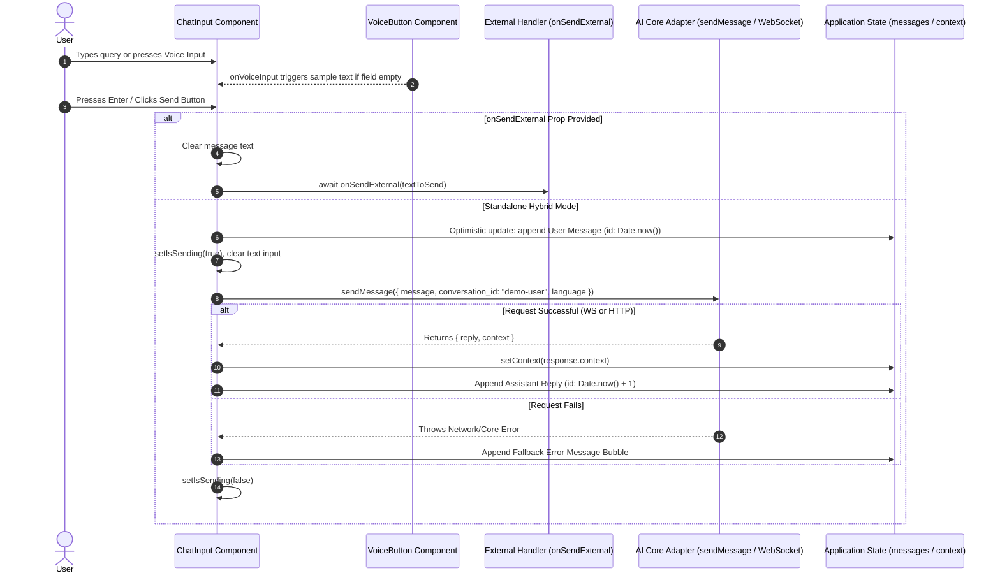

# ChatInput Component Documentation

## High-Level Overview

The `ChatInput` component (`ChatInput.jsx`) provides the rich user interaction bar at the bottom of the ArthaNetra AI chat interface. Its primary business purpose is to capture user queries regarding financial health, government schemes, budgets, and loans through text input or voice commands across 12 supported Indian regional languages, while dynamically indicating whether real-time **WebSocket stream telemetry** or **HTTP Core** is active.

Within the ArthaNetra AI frontend architecture, `ChatInput` serves as the primary input controller and message dispatcher. It supports dual-mode operation:
1. **Standalone / Hybrid WebSocket Mode**: Directly manages optimistic conversation state updates (`setMessages`), interacts with the real-time AI backend (`sendMessage`), and synchronizes returned financial intelligence context (`setContext`).
2. **Controlled / External Mode**: When passed an `onSendExternal` callback handler from a parent workspace controller, it delegates message transmission upwards while handling input clearing and button state management.

## Interface Breakdown

### Component Props

| Prop Name | Type | Required | Default Value | Description |
| :--- | :--- | :--- | :--- | :--- |
| `messages` | `Array<Object>` | Conditional | `undefined` | Current conversation history array. Required in standalone mode for optimistic message updates. |
| `setMessages` | `Function` | Conditional | `undefined` | State setter to append new user and assistant message objects to the active chat history. |
| `setContext` | `Function` | Conditional | `undefined` | Callback state setter to update application context with structured financial metadata returned by the AI core. |
| `language` | `string` | No | `"English"` | Current selected interface language (e.g., `"Hindi"`, `"Tamil"`). Dynamically updates input placeholder text and AI request payload. |
| `onSendExternal` | `Function` | No | `undefined` | Optional external message transmission handler. If provided, overrides default standalone API processing. |
| `connectionStatus` | `string` | No | `"connected"` | Live WebSocket connection state flag (`"connected"`, `"connecting"`, `"disconnected"`). |

### Internal State Variables

| State Variable | Type | Initial Value | Description |
| :--- | :--- | :--- | :--- |
| `message` | `string` | `""` | Controlled text input value typed by the user. |
| `isSending` | `boolean` | `false` | Indicates an active AI request execution. Disables input field and renders animated loading spinner. |

### Multilingual Placeholders Dictionary

The component contains a mapping table supporting 12 major regional languages:
- `English`, `Hindi`, `Marathi`, `Gujarati`, `Tamil`, `Telugu`, `Kannada`, `Malayalam`, `Bengali`, `Punjabi`, `Odia`, `Assamese`.

## Architecture & Flow

### Message Dispatch Pipeline Diagram

## Dependencies & Environment

### External Packages & Libraries

| Package / Module | Source / Path | Purpose |
| :--- | :--- | :--- |
| `react` | NPM (`react`) | Provides `useState` hook for local text input tracking and loading spinner flags. |
| `react-icons/fi` | NPM (`react-icons`) | Feather icons (`FiSend`, `FiLoader`, `FiRadio`) for submit button and telemetry indicators. |
| `./VoiceButton` | Internal Component | Child speech recognition component that triggers voice input callbacks. |
| `../../api/chat` | Internal Service | Provides asynchronous `sendMessage` API adapter and `chatSocket` instance. |

## Security & Limitations

### Security Protections

- **Input Trimming**: Prevents empty or whitespace-only submissions via `!textToSend.trim()` guard conditions.
- **Double-Submit Prevention**: Input field and submit button are disabled while `isSending` is active.
