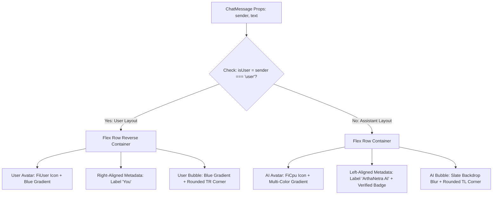

# ChatMessage Component Documentation

## High-Level Overview

The `ChatMessage` component (`ChatMessage.jsx`) is a presentation layer UI component responsible for rendering individual chat conversation turns inside the ArthaNetra AI messaging interface. Its core business role is to visually differentiate between messages sent by the user and responses generated by the ArthaNetra AI core.

Within the frontend architecture, `ChatMessage` is a stateless functional component instantiated iteratively by `ChatWindow`. It applies modern design principles—including dynamic flexbox orientation, custom color gradients, verified advisor badges, and backdrop blur effects—to deliver a visually polished, readable conversation transcript.

## Interface Breakdown

### Component Props

| Prop Name | Type | Required | Default Value | Description |
| :--- | :--- | :--- | :--- | :--- |
| `sender` | `string` | Yes | `undefined` | Identifies the originator of the message turn. Must be either `"user"` or `"assistant"`. Controls avatar selection, alignment, and color scheme. |
| `text` | `string` | Yes | `undefined` | The actual text content or markdown formatted string to display within the message speech bubble. |

### Visual Elements & Style Variations

| Attribute | User Message (`sender === "user"`) | Assistant Message (`sender !== "user"`) |
| :--- | :--- | :--- |
| **Layout Orientation** | Right-aligned (`flex-row-reverse`, `items-end`) | Left-aligned (`flex-row`, `items-start`) |
| **Avatar Icon** | `<FiUser />` | `<FiCpu />` |
| **Avatar Styling** | Blue-to-indigo gradient (`from-blue-600 to-indigo-600`) | Indigo-to-emerald gradient (`from-indigo-600 via-blue-600 to-emerald-400`) |
| **Sender Label** | `"You"` | `"ArthaNetra AI"` |
| **Verification Badge** | None | `"Verified Advisor"` emerald pill badge with `<FiCheckCircle />` |
| **Bubble Styling** | Solid blue gradient (`from-blue-600 to-indigo-600 text-white`) | Dark translucent (`bg-slate-800/90 backdrop-blur-md border text-slate-100`) |

## Architecture & Flow

### Component Rendering Pipeline & Layout Hierarchy

## Dependencies & Environment

### External Packages & Libraries

| Package / Module | Source / Path | Purpose |
| :--- | :--- | :--- |
| `react-icons/fi` | NPM (`react-icons`) | Provides Feather icons: `FiCpu` (AI avatar), `FiUser` (user avatar), and `FiCheckCircle` (Verified Advisor status pill). |

### Environment Variables

The `ChatMessage` component is purely presentational and has no external system dependencies or environment variable requirements.

## Security & Limitations

### Security Considerations

- **XSS Prevention via Text Node Rendering**: The component renders message strings safely inside standard JSX `
` text nodes (`
{text}
`). This guarantees that any malicious HTML or script tags injected via user input or simulated responses are automatically HTML-encoded by React and rendered as safe literal text rather than executable DOM nodes.

### Known Limitations & UX Edge Cases

- **Lack of Rich Markdown Parsing**: While `
` correctly renders line breaks (`\n`), the component does not natively parse or style complex markdown elements such as bolding (`**text**`), bulleted lists, code blocks, or markdown tables often output by LLMs.
- **Long Text Overflow**: Extremely long continuous character strings without spaces (e.g., raw URLs or wallet hashes) could stretch the message bubble beyond the `max-w-[80%]` container width unless CSS word-break properties (`break-words`) are explicitly applied.
