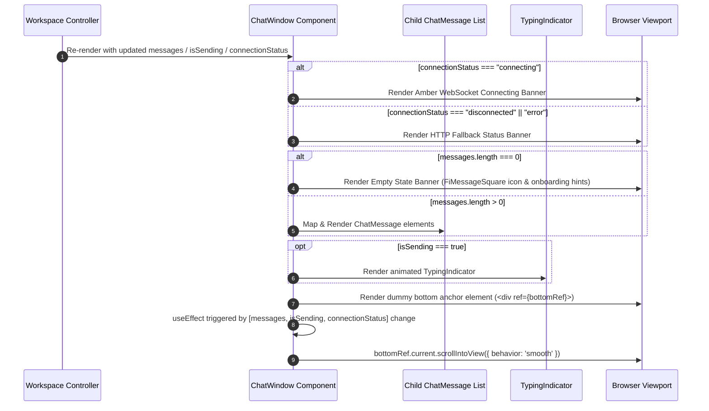
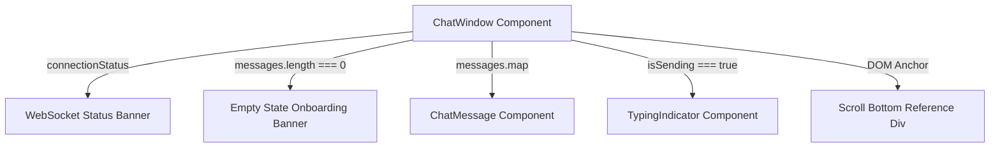

# ChatWindow Component Documentation

## High-Level Overview

The `ChatWindow` component (`ChatWindow.jsx`) serves as the scrollable container and viewport for active chat transcripts in the ArthaNetra AI interface. Its core business purpose is to present chronological message turns between the user and AI, handle zero-state (empty conversation) onboarding prompts, display animated typing indicators during pending AI reasoning cycles, render live WebSocket connection status banners (`connecting`, `disconnected`, `error`), and automatically keep the user viewport anchored to the newest messages.

Within the frontend architecture, `ChatWindow` operates as an intermediate presentation container. It receives the conversation message array, typing state flags, and live connection status from workspace controllers, orchestrating the iterative rendering of child `ChatMessage` components and visual status banners.

## Interface Breakdown

### Component Props

| Prop Name | Type | Required | Default Value | Description |
| :--- | :--- | :--- | :--- | :--- |
| `messages` | `Array<Object>` | No | `[]` | List of conversation turn objects. Each object must contain `id` (unique key), `sender` (`"user"` or `"assistant"`), and `text` properties. |
| `isSending` | `boolean` | No | `false` | Flag indicating whether the assistant is currently processing a response. Controls rendering of the child `TypingIndicator`. |
| `connectionStatus` | `string` | No | `"connected"` | Connection state of the WebSocket stream (`"connected"`, `"connecting"`, `"disconnected"`, `"error"`). Displays real-time status banners when establishing or operating in HTTP fallback mode. |

### Internal Hooks & DOM References

| Reference / Hook | Type | Purpose |
| :--- | :--- | :--- |
| `bottomRef` | `React.RefObject` | Attached to a dummy `
` element positioned at the bottom of the message container. Used as the anchor point for programmatic scrolling. |
| `useEffect` | React Lifecycle Hook | Watches `messages`, `isSending`, and `connectionStatus` dependency array. Invokes `bottomRef.current?.scrollIntoView({ behavior: "smooth" })` whenever new messages arrive or connection status toggles. |

## Architecture & Flow

### Render & Scroll Lifecycle Pipeline

### Component Hierarchy

## Dependencies & Environment

### External Packages & Libraries

| Package / Module | Source / Path | Purpose |
| :--- | :--- | :--- |
| `react` | NPM (`react`) | Provides `useEffect` and `useRef` hooks for DOM manipulation and lifecycle tracking. |
| `react-icons/fi` | NPM (`react-icons`) | Feather icons (`FiMessageSquare`, `FiWifi`, `FiAlertCircle`) rendered inside banners and onboarding badges. |
| `./ChatMessage` | Internal Component | Child component responsible for styling and rendering individual user or assistant text bubbles. |
| `./TypingIndicator` | Internal Component | Child component displaying pulsing dots animation when the AI is formulating an answer. |

## Security & Limitations

### Security Protections

- **Safe Iteration**: Delegates message content rendering directly to `ChatMessage`, maintaining protection against script injection and XSS vulnerabilities.

### Known Limitations & Performance Bottlenecks

- **Unbound Array Rendering (No Virtualization)**: The component maps over the entire `messages` array on every render. For extremely long conversation sessions (e.g., 500+ messages), implementing windowed list virtualization (e.g., `react-window` or `@tanstack/react-virtual`) is recommended.
