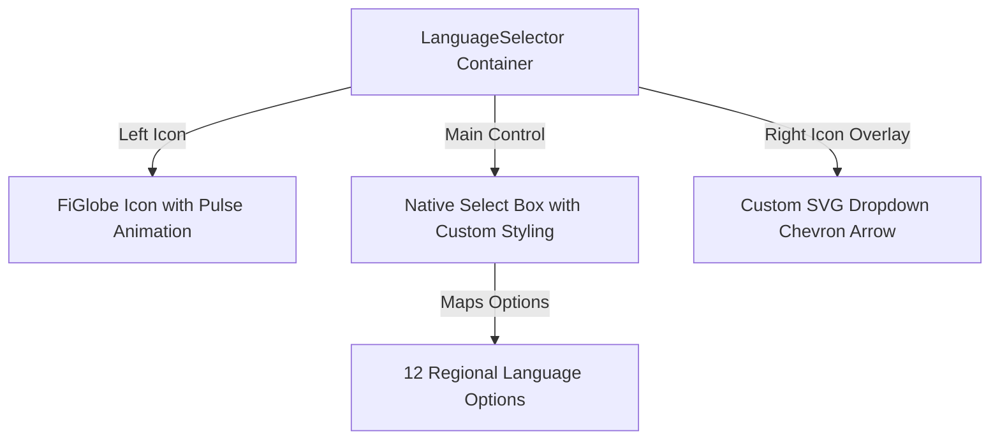

# LanguageSelector Component Documentation

## High-Level Overview

The `LanguageSelector` component (`LanguageSelector.jsx`) provides a compact, customized dropdown menu enabling users to switch the active interaction language within the ArthaNetra AI interface. Its primary business purpose is to make inclusive financial AI counseling accessible across diverse linguistic demographics across India by supporting 12 regional and official languages.

Within the frontend architecture, `LanguageSelector` functions as a controlled UI input element embedded in chat or workspace header toolbars. When a user selects a new language option, the component triggers state updates in parent controllers, which subsequently adapt placeholder prompts, voice input processing, and AI response generation parameters to match the chosen dialect.

## Interface Breakdown

### Component Props

| Prop Name | Type | Required | Default Value | Description |
| :--- | :--- | :--- | :--- | :--- |
| `language` | `string` | Yes | `undefined` | The currently selected language string (e.g., `"English"`, `"Hindi"`). Controls the selected option value in the dropdown. |
| `setLanguage` | `Function` | Yes | `undefined` | Callback state setter function invoked when the user selects a new language option from the `<select>` menu. |

### Supported Languages Array

The component encapsulates a hardcoded list of 12 supported vernaculars:
- `English`, `Hindi`, `Marathi`, `Gujarati`, `Tamil`, `Telugu`, `Kannada`, `Malayalam`, `Bengali`, `Punjabi`, `Odia`, `Assamese`.

## Architecture & Flow

### Event & State Interaction Pipeline

```mermaid
sequenceDiagram
    autonumber
    actor User
    participant LS as LanguageSelector Component
    participant Parent as Workspace / Chat Controller

    User->>LS: Clicks dropdown & selects new dialect (e.g., "Tamil")
    LS->>LS: onChange event captured on native <select>
    LS->>Parent: setLanguage("Tamil")
    Parent->>Parent: Updates global language state
    Parent-->>LS: Re-renders with updated language prop
```

### Component UI Structure

## Dependencies & Environment

### External Packages & Libraries

| Package / Module | Source / Path | Purpose |
| :--- | :--- | :--- |
| `react-icons/fi` | NPM (`react-icons`) | Provides the Feather globe icon (`FiGlobe`) rendered with an animated pulse effect to signify global/regional accessibility. |

### Environment Variables

Does not access or require any environment variables. Completely stateless internally, relying on external controlled props.

## Security & Limitations

### Security Protections

- **Safe Selection Constraints**: Because dropdown options are strictly rendered from a hardcoded whitelist array (`languages.map(...)`), the component prevents arbitrary user input or script injection via language selection.

### Known Limitations & Potential Improvements

- **Hardcoded Language List**: The array of languages is defined statically inside the component render body (`const languages = [...]`). Reallocating this array on every re-render slightly impacts garbage collection. Moving the array outside the component scope as a module-level constant or fetching supported languages dynamically from a backend localization API endpoint would improve architectural flexibility and performance.
- **Native Select Styling Consistency**: Uses a native HTML `<select>` with appearance removal (`appearance-none`). While wrapper styling creates a consistent dark-theme look across desktop browsers, mobile operating systems (iOS Safari, Android Chrome) often override native select option rendering with system-default modal pickers.
