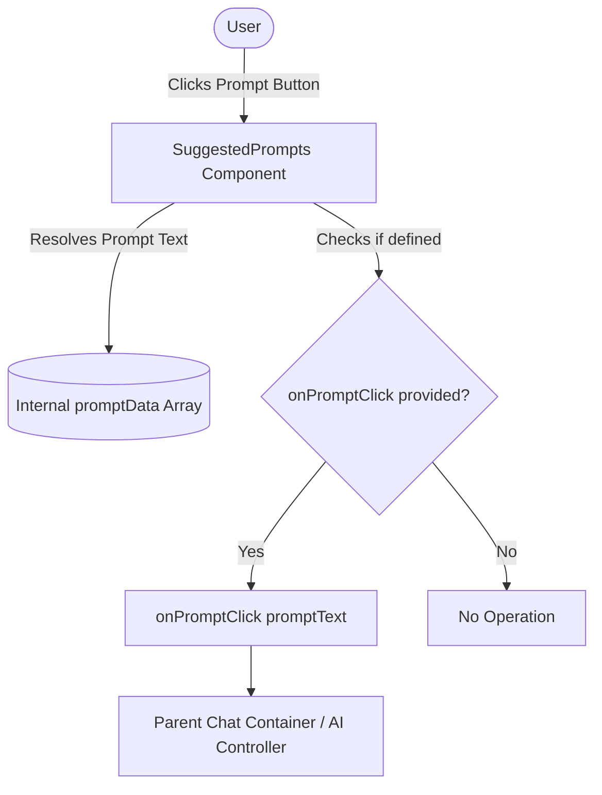

# SuggestedPrompts Component Documentation

## High-Level Overview
The `SuggestedPrompts` component renders a dynamic, interactive toolbar containing pre-configured AI query recommendations for the ArthaNetra AI interface. Its primary business logic is to reduce cognitive load for users and accelerate engagement with the conversational interface by presenting high-value domain-specific financial queries (such as budgeting, loan safety checks, government scheme discovery, and financial score improvement). 

Within the application layout, it is positioned directly above or below the chat input box, providing categorized, visually distinct buttons that trigger quick query submissions when clicked.

## Interface Breakdown

### Component Props
| Prop Name | Type | Required | Default | Description |
| :--- | :--- | :--- | :--- | :--- |
| `onPromptClick` | `function` | Optional | `undefined` | Callback function executed when a user selects a suggested prompt button. Receives the prompt string text as its sole argument (`(promptText: string) => void`). |

### Internal Configuration Data (`promptData`)
The component internally manages a static array of prompt configurations representing key financial AI workflows:

| Property | Type | Description |
| :--- | :--- | :--- |
| `text` | `string` | The exact prompt text displayed to the user and sent to the `onPromptClick` handler. |
| `icon` | `React.ComponentType` | The React Icon component (`react-icons/fi`) visually representing the category. |
| `category` | `string` | Classification domain of the prompt (e.g., `Planning`, `Security`, `Benefits`, `Growth`). |
| `gradient` | `string` | Tailwind CSS utility classes specifying hover styling, borders, and text color schemes. |

## Architecture & Flow

## Dependencies & Environment

### External Packages
- **`react-icons/fi`**: Provides modern Feather icons (`FiZap`, `FiPieChart`, `FiShield`, `FiAward`, `FiTrendingUp`, `FiArrowUpRight`) used for rich visual categorization.
- **Tailwind CSS**: Utilized extensively for backdrop blurring (`backdrop-blur-md`), responsive grid layouts (`grid-cols-1 sm:grid-cols-2 lg:grid-cols-4`), hover animations, and subtle gradient shifts.

### Runtime Environment
- Operates fully on the client-side within a standard React 18+ environment.
- Does not directly interact with backend APIs or require environment variables; relies on parent container delegation for API transmission.

## Security & Limitations

### Edge Cases & Limitations
- **Optional Callback Guarding**: The click handler safely checks `onPromptClick && onPromptClick(item.text)` to prevent runtime exceptions if the parent component fails to provide a callback.
- **Static Dataset**: Currently, `promptData` is hardcoded inside the component body. If user-specific or AI-generated personalized prompts are required in the future, the component will need refactoring to accept `promptData` via props or context.
- **Text Truncation**: Long prompt strings are protected against layout breakage using the `truncate` utility class, but extremely narrow viewports on mobile devices might hide critical context if prompt lengths increase significantly.
