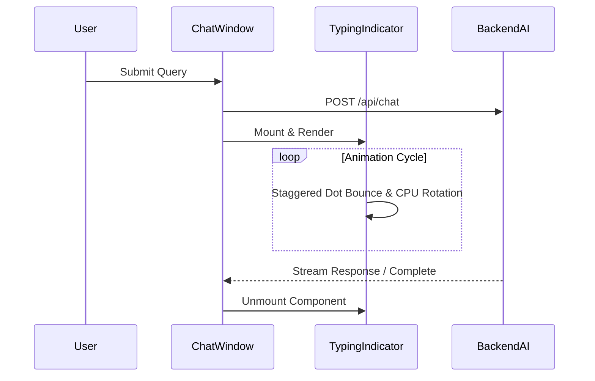

# TypingIndicator Component Documentation

## High-Level Overview
The `TypingIndicator` component is a dedicated UI element designed to communicate AI processing state and system activity to the user in real time. Its business logic centers on user experience (UX) enhancement by providing immediate visual feedback after a user submits a prompt while ArthaNetra AI synthesizes complex financial advice.

Within the application's chat interface, this component appears in the conversation stream formatted as an incoming message from the assistant (`ArthaNetra AI`), featuring animated status indicators that signify ongoing backend reasoning or token streaming.

## Interface Breakdown

### Component Props
The `TypingIndicator` component accepts no external props, rendering a self-contained, standardized loading state.

| Parameter | Type | Required | Default | Description |
| :--- | :--- | :--- | :--- | :--- |
| `props` | `None` | N/A | N/A | Stateless functional component that renders standard typing animation. |

### Visual Elements Structure
| Element | CSS / Styling Attributes | Animation Characteristics |
| :--- | :--- | :--- |
| **AI Avatar** | `w-9 h-9 rounded-xl bg-gradient-to-tr from-indigo-600 via-blue-600 to-emerald-400` | Contains an animated CPU icon (`FiCpu`) spinning with a 3-second cycle duration. |
| **Bouncing Dots** | 3 distinct circular dots (`w-2 h-2 rounded-full`) in blue, indigo, and emerald gradients | Continuous vertical bounce (`animate-bounce`) staggered with exact animation delays (`0ms`, `150ms`, `300ms`). |
| **Status Label** | `text-xs sm:text-sm font-medium bg-gradient-to-r` | Displays text: *"Synthesizing financial advice..."* with a gradient clip. |

## Architecture & Flow

## Dependencies & Environment

### External Packages
- **`react-icons/fi`**: Employs the `FiCpu` Feather icon representing artificial intelligence processor core operations.
- **Tailwind CSS**: Requires custom or standard animation classes (`animate-fadeIn`, `animate-spin`, `animate-bounce`) along with gradient text clipping utilities (`bg-clip-text text-transparent`).

### Runtime & System Requirements
- Pure UI component executed inside the React browser DOM.
- No external environment variables or network hooks required.

## Security & Limitations

### Known Limitations
- **Fixed Messaging**: The status text *"Synthesizing financial advice..."* is hardcoded. If distinct AI stages exist (e.g., *Retrieving Government Schemes*, *Calculating Risk Factors*), the component currently cannot reflect granular progress without extending props.
- **CSS Animation Performance**: Uses continuous CSS keyframe animations (`spin` and `bounce`). On severely resource-constrained or legacy mobile browsers, multiple simultaneous CSS animations can slightly impact frame rates if not hardware-accelerated.
