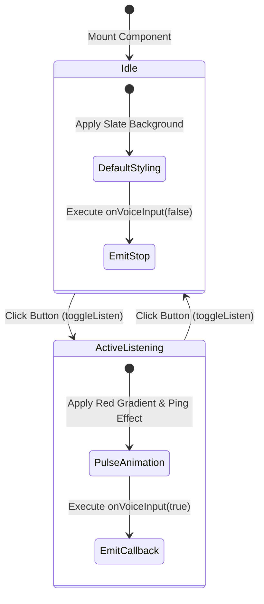

# VoiceButton Component Documentation

## High-Level Overview
The `VoiceButton` component is an interactive speech-to-text control toggle that equips ArthaNetra AI with speech recognition capabilities. Its core purpose is to allow accessibility-focused or hands-free financial queries by letting users toggle microphone input directly from the chat prompt bar.

Business logic revolves around managing the local acoustic listening state (`isListening`), visually reflecting active microphone capture with pulsating indicators, and signaling state transitions to the parent container so audio recording or Web Speech API transcription hooks can be toggled.

## Interface Breakdown

### Component Props
| Prop Name | Type | Required | Default | Description |
| :--- | :--- | :--- | :--- | :--- |
| `onVoiceInput` | `function` | Optional | `undefined` | Callback invoked when the user toggles the microphone button. Passes the updated listening boolean state (`(isListening: boolean) => void`). |

### Internal State (`useState`)
| State Variable | Type | Initial Value | Description |
| :--- | :--- | :--- | :--- |
| `isListening` | `boolean` | `false` | Tracks whether the microphone is actively capturing voice input. Controls button styling, tooltip text, and active icon display. |

## Architecture & Flow

## Dependencies & Environment

### External Packages
- **`react`**: Uses standard React hook `useState` for local state tracking.
- **`react-icons/fi`**: Employs `FiMic` (idle microphone) and `FiMicOff` (active/stop recording indicator).
- **Tailwind CSS**: Leverages state-driven dynamic styling including radar ping animations (`animate-ping`) and shadow glow effects (`shadow-red-500/30`).

### Environment Variables & APIs
- While this UI component handles state presentation, actual speech synthesis or Web Speech API integration (`window.SpeechRecognition` or `webkitSpeechRecognition`) is expected to be handled by the parent container listening to `onVoiceInput`.

## Security & Limitations

### Edge Cases & Limitations
- **Desynchronization Risk**: Because `isListening` is stored inside local state rather than controlled externally via props, if the browser's speech recognition engine times out or encounters a microphone permission error, the button state may remain desynchronized until clicked again.
- **Microphone Permissions**: The component does not catch or handle browser-level media device permission denials (`NotAllowedError`). The parent handler managing `onVoiceInput` must implement appropriate error boundary alerts if microphone access is blocked.
