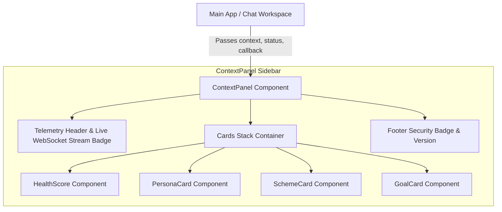

# ContextPanel Component Documentation

## High-Level Overview
The `ContextPanel` serves as the real-time AI telemetry and user intelligence sidebar for the ArthaNetra AI frontend. Its core purpose is to visualize dynamic contextual parameters—such as the user's financial health index, assigned demographic persona and income profile, eligible government schemes, and primary financial goals—in a persistent vertical dashboard while showing live **WebSocket telemetry streaming status**.

Within the application architecture, it acts as the primary container aggregating stateful user metrics extracted from AI session contexts or live socket updates, giving users transparency into how the AI model evaluates their profile during financial consultation.

## Interface Breakdown

### Component Props
| Prop Name | Type | Required | Default | Description |
| :--- | :--- | :--- | :--- | :--- |
| `context` | `object` | Optional | `{}` | Top-level context object containing telemetry values and user state parameters evaluated by ArthaNetra AI. |
| `connectionStatus` | `string` | Optional | `"connected"` | Real-time WebSocket status indicator (`"connected"`, `"connecting"`, `"disconnected"`). |
| `onGoalClick` | `Function` | Optional | `undefined` | Callback invoked when the user interacts with the GoalCard optimize action. Dispatches prompts into the chat console. |

### `context` Object Schema Breakdown
| Property | Expected Type | Description | Passed To Component |
| :--- | :--- | :--- | :--- |
| `financial_health_score` | `number` | Numerical score representing overall financial well-being (0-100). | `<HealthScore />` |
| `persona` | `string` | Categorical user classification (e.g., `"Student"`, `"Farmer"`). | `<PersonaCard />` |
| `income_type` | `string` | User income profile classification (e.g., `"Variable"`, `"Salaried"`). | `<PersonaCard />` |
| `eligible_schemes` | `string[]` | List of detected government schemes or grants applicable to the profile. | `<SchemeCard />` |
| `goal` | `string` | Active primary financial objective (e.g., `"Increase Savings"`). | `<GoalCard />` |

## Architecture & Flow

## Dependencies & Environment

### Sub-Components & External Packages
- **Internal Components**:
  - `HealthScore`: Displays numerical assessment and progress bar.
  - `PersonaCard`: Shows user profile tier, income type, and verification status.
  - `SchemeCard`: Renders list of matching scheme titles.
  - `GoalCard`: Presents target financial optimization targets and triggers interactive advice prompts.
- **`react-icons/fi`**: Provides structural iconography (`FiBarChart2`, `FiShield`).
- **Tailwind CSS**: Uses custom scrollbar styling (`scrollbar-thin scrollbar-thumb-slate-700`) and translucent backdrop blurs (`backdrop-blur-2xl`).

## Security & Limitations

### Safeguards & Overflow Handling
- **Null / Undefined Safeties**: The component gracefully falls back to `{}` if `context` is omitted, safely passing defaults to prevent rendering errors.
- **Overflow Handling**: The panel employs `overflow-y-auto` to handle scenarios where eligible schemes or additional telemetry cards exceed vertical viewport height.
