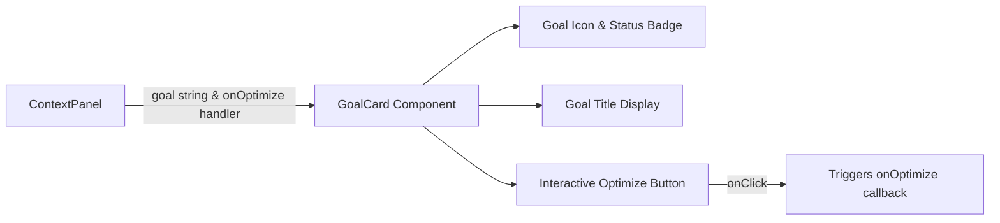

# GoalCard Component Documentation

## High-Level Overview
The `GoalCard` component displays the user's primary financial target within the ArthaNetra AI context dashboard. Its core purpose is to maintain user focus on actionable financial milestones (such as increasing savings, debt consolidation, or retirement planning) and highlight that the AI is actively tailoring its advice toward achieving that objective.

Within the user interface, it renders a sleek card featuring an "In Progress" badge and an interactive call-to-action button ("Optimize") that dispatches optimization queries directly into the chat console when clicked.

## Interface Breakdown

### Component Props
| Prop Name | Type | Required | Default | Description |
| :--- | :--- | :--- | :--- | :--- |
| `goal` | `string` | Optional | `"Increase Savings"` | The text label specifying the user's active primary financial objective. |
| `onOptimize` | `Function` | Optional | `undefined` | Callback function invoked when the user clicks the Optimize button. Passes a formulated optimization query string upwards. |

### Visual Elements Breakdown
| Element | Description | Styling Highlights |
| :--- | :--- | :--- |
| **Icon Container** | Target icon (`FiTarget`) indicating goal-oriented tracking. | Pink theme gradient (`bg-pink-500/10 border-pink-500/20 text-pink-400`). |
| **Status Badge** | Static status pill indicating ongoing assessment. | Text label `"In Progress"` in pink styling. |
| **Optimize Action** | Interactive button prompting AI goal optimization. | Translating right arrow (`FiArrowRight`) on group hover. |

## Architecture & Flow

## Dependencies & Environment

### External Packages
- **`react-icons/fi`**: Provides modern Feather icons (`FiTarget`, `FiArrowRight`).
- **Tailwind CSS**: Employs hover transitions (`group-hover/btn:translate-x-0.5`), subtle dark gradients (`from-slate-900 via-slate-900/90 to-pink-950/30`), and border highlighting.

## Security & Limitations

### Interactions & Safeguards
- **Interactive Optimization Button**: Fully connected via `onOptimize`, dispatching a formulated prompt (`"Help me optimize and reach my financial goal: ..."`) into the active workspace chat session upon user click.
