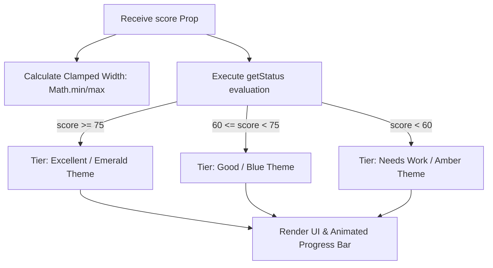

# HealthScore Component Documentation

## High-Level Overview
The `HealthScore` component renders a dynamic quantitative visualization of a user's financial well-being assessed by ArthaNetra AI. Its business logic evaluates a numerical index (0 to 100) and categorizes the user into qualitative health tiers ("Excellent", "Good", or "Needs Work"), dynamically styling visual badges and progress bars accordingly.

Within the Context Panel, this component occupies the top card position, giving immediate visual feedback on the user's financial stability along with month-over-month (MoM) growth trajectory indicators.

## Interface Breakdown

### Component Props
| Prop Name | Type | Required | Default | Description |
| :--- | :--- | :--- | :--- | :--- |
| `score` | `number` | Optional | `72` | The AI-assessed financial health score ranging from 0 to 100. |

### Internal Evaluation Function (`getStatus`)
| Range | Qualitative Label | Color Styling Class | Progress Bar Gradient |
| :--- | :--- | :--- | :--- |
| `val >= 75` | `"Excellent"` | `text-emerald-400 bg-emerald-500/10 border-emerald-500/30` | `from-emerald-500 to-teal-400` |
| `60 <= val < 75` | `"Good"` | `text-blue-400 bg-blue-500/10 border-blue-500/30` | `from-blue-500 to-indigo-400` |
| `val < 60` | `"Needs Work"` | `text-amber-400 bg-amber-500/10 border-amber-500/30` | `from-amber-500 to-orange-400` |

## Architecture & Flow

## Dependencies & Environment

### External Packages
- **`react-icons/fi`**: Employs activity and trend iconography (`FiActivity`, `FiTrendingUp`).
- **Tailwind CSS**: Uses transition duration utilities (`duration-700 ease-out`) for smooth progress bar width adjustments.

### Environment Interaction
- Pure functional component running client-side with no external network dependencies.

## Security & Limitations

### Edge Cases & Safeguards
- **Value Clamping**: The inline style for progress bar width employs strict mathematical clamping (`Math.min(100, Math.max(5, score))%`) ensuring that negative numbers or values exceeding 100 do not break CSS layouts or render invisible bars.
- **Static MoM Metric**: The indicator showing `+4 pts MoM` is currently hardcoded into the component JSX. Future versions should accept trend data as an optional prop or object schema (`{ score: number, trend: string }`).
