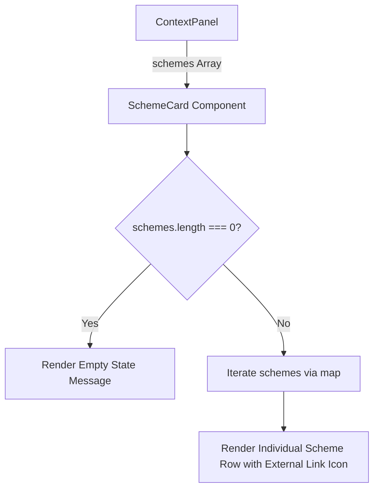

# SchemeCard Component Documentation

## High-Level Overview
The `SchemeCard` component enumerates government support schemes, subsidies, and financial aid packages that match the user's demographic profile and eligibility criteria. Its primary business logic is to connect users directly with actionable government welfare programs identified during AI consultations.

Positioned inside the Context Panel, it displays an interactive item list featuring verified checkmarks and external link icons, along with an active scheme counter badge.

## Interface Breakdown

### Component Props
| Prop Name | Type | Required | Default | Description |
| :--- | :--- | :--- | :--- | :--- |
| `schemes` | `string[]` | Optional | `[]` | Array of strings representing the titles of eligible government schemes. |

### Component States
| State | Trigger Condition | Rendered Output |
| :--- | :--- | :--- |
| **Empty State** | `schemes.length === 0` | Displays italic fallback text: *"No specific schemes detected yet."* |
| **Populated State** | `schemes.length > 0` | Renders a vertical stack of interactive scheme cards with checkmark icons and external link indicators. |

## Architecture & Flow

## Dependencies & Environment

### External Packages
- **`react-icons/fi`**: Employs award badge (`FiAward`), success checkmark (`FiCheckCircle`), and external navigation icon (`FiExternalLink`).
- **Tailwind CSS**: Employs group hover animations (`group-hover:border-amber-500/40`), amber highlighting, and rounded container boxes.

### Runtime Environment
- Standard React functional component requiring no direct backend storage or environment variables.

## Security & Limitations

### Edge Cases & Safeguards
- **List Key Collision Prevention**: The component uses `key={scheme}` during array mapping. If duplicate scheme titles exist in the `schemes` array, React will emit duplicate key warnings. Ensuring array uniqueness or combining scheme strings with indices (`key={`${scheme}-${index}`}`) is recommended if backend deduplication is not guaranteed.
- **Unbound Navigation Handlers**: Currently, clicking the external link icon (`FiExternalLink`) does not trigger window navigation (`window.open`). Extending the input schema to object arrays containing URLs (`{ title: string, url: string }[]`) will enable direct outbound navigation to government portal endpoints.
