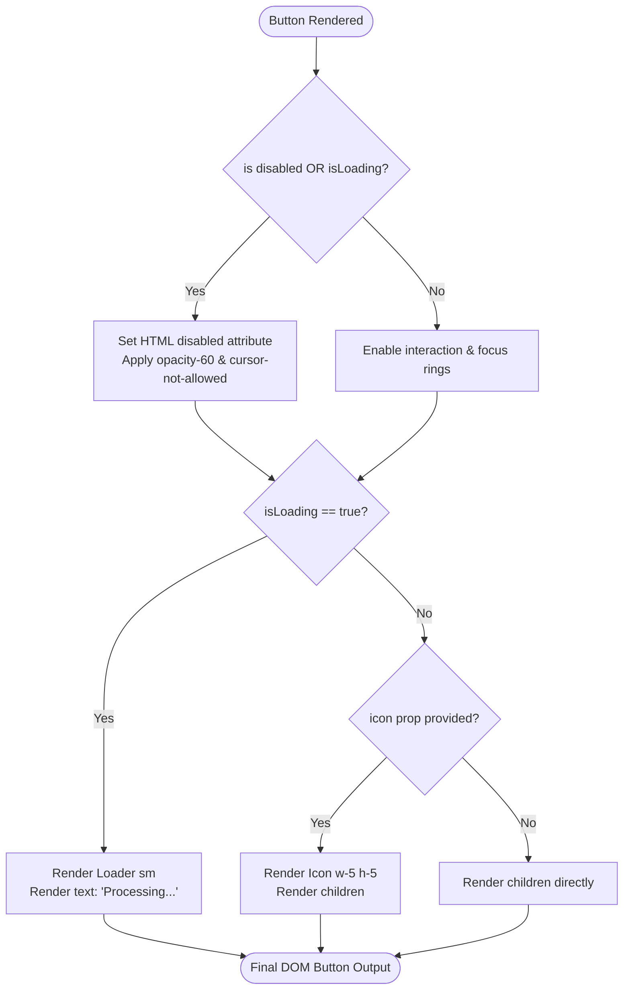

# Button Component Documentation

## High-Level Overview

The `Button` component (`Button.jsx`) is a foundational shared UI element within **ArthaNetra AI**. Its core purpose is to provide an accessible, tactile, and visually consistent interaction primitive across all forms, dialogs, and navigation flows.

### Core Purpose & Business Logic
* **Design System Enforcement:** Standardizes button ergonomics using rounded 2xl borders, smooth active scale transforms (`active:scale-[0.98]`), focus rings for keyboard accessibility, and three distinct design variants (`primary`, `secondary`, `outline`).
* **Asynchronous State Handling:** Seamlessly intercepts click interactions during background operations. When `isLoading` is set to `true`, the button automatically disables itself, prevents re-clicks, and swaps its content for a spinning `Loader` accompanied by a status indicator (`Processing...`).
* **Icon Composition:** Supports leading icon components passed via the `icon` prop, maintaining uniform spacing and vertical alignment next to text labels.

---

## Interface Breakdown

### Component Signature & Return Type
* **Component Name:** `Button`
* **Return Type:** `JSX.Element`

### Props & Parameters Table

| Prop Name | Type | Default Value | Description |
| :--- | :--- | :--- | :--- |
| `children` | `React.ReactNode` | Required | Content displayed inside the button (text label or child elements). |
| `onClick` | `(event: React.MouseEvent<HTMLButtonElement>) => void` | `undefined` | Callback function executed when the user clicks the button. |
| `type` | `"button" \| "submit" \| "reset"` | `"button"` | HTML form button type attribute specifying form submission behavior. |
| `variant` | `"primary" \| "secondary" \| "outline"` | `"primary"` | Controls color palette, gradients, shadows, and borders. Falls back to `primary` if an invalid variant is supplied. |
| `isLoading` | `boolean` | `false` | When `true`, disables the button and renders a compact spinner with `"Processing..."` text. |
| `disabled` | `boolean` | `false` | When `true`, applies reduced opacity (`opacity-60`), disables pointer events, and blocks clicks. |
| `className` | `string` | `""` | Additional Tailwind utility classes merged onto the `<button>` root element. |
| `icon` | `React.ElementType` | `null` | Optional React icon component (e.g., from `react-icons`) rendered to the left of `children`. |

---

## Architecture & Flow

### Render Logic & State Hierarchy Diagram

---

## Dependencies & Environment

### External & Internal Dependencies

| Dependency | Type | Purpose |
| :--- | :--- | :--- |
| `Loader` | Internal Shared Component | Imported from `./Loader` to display spinning animation during `isLoading` states. |

### Environment Variables & API Interactions
* **Environment Variables:** None required.
* **API/Data Interactions:** Pure presentation component; delegates API actions to parent `onClick` handlers.

---

## Security & Limitations

### Security Considerations
* **Safe DOM Rendering:** Renders standard `<button>` DOM nodes. No direct risk of HTML injection unless untrusted strings with raw HTML are explicitly forced into `children` via unsafe parent patterns.

### Limitations & Edge Cases
* **Hardcoded Loading Text:** When `isLoading` is `true`, the text label is hardcoded to `"Processing..."`. In a multilingual application like ArthaNetra AI, this prevents dynamic localization of the loading state unless modified to accept a custom loading string prop.
* **Class Name Collision:** `className` concatenation uses simple string template literals (`${baseStyles} ... ${className}`) rather than a utility like `tailwind-merge`, meaning overriding specific base styles (such as `py-4 px-6`) via `className` can lead to CSS specificity conflicts.
