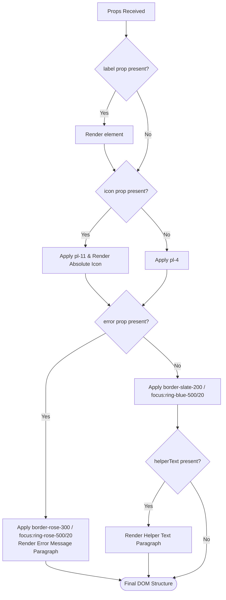

# Input Component Documentation

## High-Level Overview

The `Input` component (`Input.jsx`) is a comprehensive form field wrapper used across **ArthaNetra AI** for structured data entry, login credentials, and search filters. It combines standardized labels, responsive padding, icon adornments, helper text, and error validation feedback into a cohesive UI primitive.

### Core Purpose & Business Logic
* **Dynamic Validation Feedback:** Automatically transitions border colors, ring shadows, and text hues to red/rose palettes (`border-rose-300`, `text-rose-900`) when an `error` prop is supplied, displaying animated error messages with indicator dots.
* **Icon Integration:** Automatically adjusts left padding (`pl-11` vs `pl-4`) when a leading icon component (`Icon`) is injected, preventing text overlap while maintaining visual balance.
* **Accessible Form Hierarchy:** Explicitly associates labels, input attributes (`name`, `type`, `maxLength`), and assistive feedback (`helperText`) to ensure clean semantic form markup.

---

## Interface Breakdown

### Component Signature & Return Type
* **Component Name:** `Input`
* **Return Type:** `JSX.Element`

### Props & Parameters Table

| Prop Name | Type | Default Value | Description |
| :--- | :--- | :--- | :--- |
| `label` | `string` | `undefined` | Optional top label displayed above the input box. |
| `type` | `string` | `"text"` | HTML input type (e.g., `"text"`, `"password"`, `"email"`, `"number"`). |
| `placeholder` | `string` | `undefined` | Placeholder string displayed when the input field is empty. |
| `value` | `string \| number` | `undefined` | Controlled input value bound to parent state. |
| `onChange` | `(event: React.ChangeEvent<HTMLInputElement>) => void` | `undefined` | Event handler triggered on value change. |
| `onBlur` | `(event: React.FocusEvent<HTMLInputElement>) => void` | `undefined` | Event handler triggered when focus leaves the input field. |
| `error` | `string` | `undefined` | Validation error message string. When present, overrides helper text and triggers error styling. |
| `icon` | `React.ElementType` | `undefined` | Optional React icon component displayed inside the left edge of the input. |
| `helperText` | `string` | `undefined` | Informational or instructional guidance displayed below the input when no error is active. |
| `maxLength` | `number` | `undefined` | Maximum number of characters permitted in the input field. |
| `disabled` | `boolean` | `false` | Disables the input, changes background to gray (`bg-slate-100`), and blocks user interactions. |
| `className` | `string` | `""` | Additional Tailwind classes appended to the outer wrapper `
`. |
| `name` | `string` | `undefined` | HTML form input name attribute used during serialization or form data parsing. |

---

## Architecture & Flow

### Conditional Rendering & Styling Flow Diagram

---

## Dependencies & Environment

### External & Internal Dependencies

| Dependency | Type | Purpose |
| :--- | :--- | :--- |
| `React` (Implicit) | Core Framework | JSX functional component rendering. |

### Environment Variables & API Interactions
* **Environment Variables:** None required.
* **API/Data Interactions:** Pure presentation and form primitive; data binding is controlled by parent components.

---

## Security & Limitations

### Security Considerations
* **Input Sanitization:** Standard `<input>` DOM element. Data captured through `onChange` must be sanitized by parent form controllers or backend API consumers to prevent XSS or SQL injection attacks.

### Limitations & Edge Cases
* **Single-Line Limitation:** Does not auto-expand or support multi-line input (requires a separate `<textarea>` component).
* **Missing Password Visibility Toggle:** If `type="password"` is passed, there is no built-in eye icon toggle to reveal or hide masked passwords.
