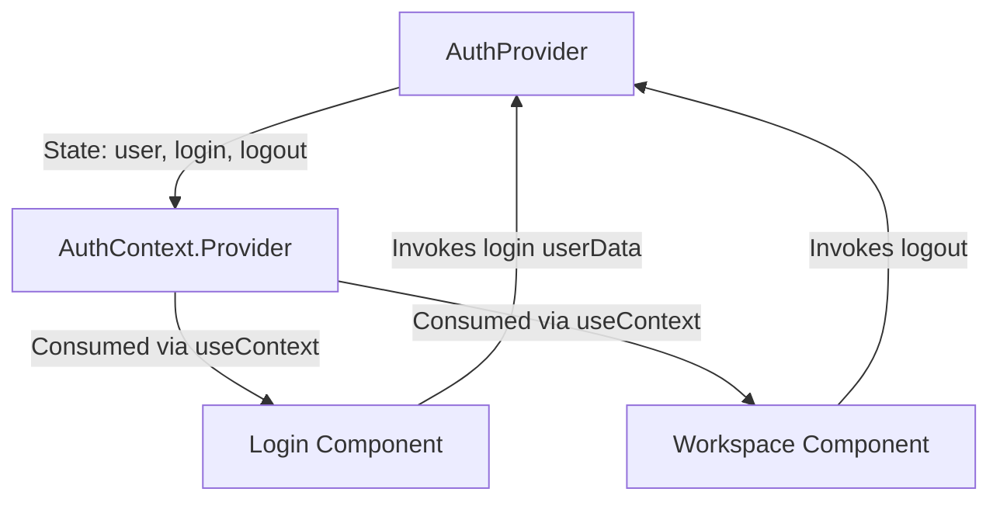

# AuthContext.jsx Documentation

## High-Level Overview
`AuthContext.jsx` implements the React Context API pattern to manage global authentication state across the ArthaNetra AI application. It provides a central state store (`user`) along with mutator methods (`login` and `logout`). Any child component within the `AuthProvider` tree can consume this context to verify user identity, display user-specific data, or trigger session state transitions without prop drilling.

## Interface Breakdown

| Component / Export | Type | Parameters / Props | Return Type | Description |
| :--- | :--- | :--- | :--- | :--- |
| `AuthContext` | React Context Object | None | `Context` | Created via `createContext()`; consumed via `useContext(AuthContext)`. |
| `AuthProvider` | React Provider Component | `{ children: ReactNode }` | `JSX.Element` | Context Provider component wrapping children with state value payload. |

### Context Value Payload

| Property / Method | Type | Arguments | Description |
| :--- | :--- | :--- | :--- |
| `user` | `Object \| null` | N/A | Stores active user object details or `null` if unauthenticated. |
| `login` | `Function` | `userData: Object` | Updates `user` state with authenticated profile data. |
| `logout` | `Function` | None | Resets `user` state to `null`. |

## Architecture & Flow

## Dependencies & Environment

| Dependency | Type | Purpose |
| :--- | :--- | :--- |
| `react` | External Package | Imports `createContext` for context initialization and `useState` for state management. |

## Security & Limitations
- **Volatile Memory Storage:** State is stored strictly in React runtime memory (`useState`). Refreshing the browser page clears the `user` state, causing the session to revert to `null` even if a JWT token remains stored in `localStorage`.
- **No Token Storage Synchronization:** `login` and `logout` only mutate local component state; they do not automatically set or clear `localStorage.getItem("token")`, requiring consuming components to handle web storage persistence separately.
