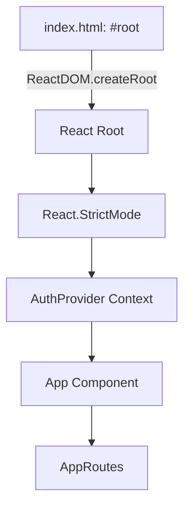

# main.jsx Documentation

## High-Level Overview
`main.jsx` is the application bootstrapping entry point for the ArthaNetra AI frontend. Its primary business role is to mount the React 18 virtual DOM into the root HTML DOM element (`#root`). It enforces strict runtime checks via `React.StrictMode`, loads global CSS styles (`index.css`), and wraps the entire application tree inside the `AuthProvider` context container to ensure authentication state is accessible across all views.

## Interface Breakdown

| Function / Method | Type | Parameters | Return Type | Description |
| :--- | :--- | :--- | :--- | :--- |
| `ReactDOM.createRoot` | DOM API | `container: Element` (`#root`) | `Root` | Initializes the React 18 concurrent root on the specified DOM node. |
| `render` | Method on Root | `children: ReactNode` | `void` | Triggers the initial rendering of `<React.StrictMode>`, `<AuthProvider>`, and `<App />`. |

## Architecture & Flow

## Dependencies & Environment

| Dependency | Type | Purpose |
| :--- | :--- | :--- |
| `react` | External Package | Core React library providing component features and `StrictMode`. |
| `react-dom/client` | External Package | Provides DOM-specific client rendering methods (`createRoot`). |
| `./index.css` | Internal Asset | Global stylesheet defining baseline styling and utility classes. |
| `./App` | Internal Component | The root structural component of the ArthaNetra application. |
| `./context/AuthContext` | Internal Provider | Context provider supplying user session state (`user`, `login`, `logout`). |

## Security & Limitations
- **DOM Node Dependency:** Assumes the existence of a DOM element with `id="root"`. If missing from `index.html`, `document.getElementById("root")` returns `null`, throwing an unhandled runtime error during initialization.
- **Strict Mode Effects:** In development mode, `React.StrictMode` intentionally double-invokes component lifecycle effects and state reducers to detect impurities and legacy lifecycle methods.
