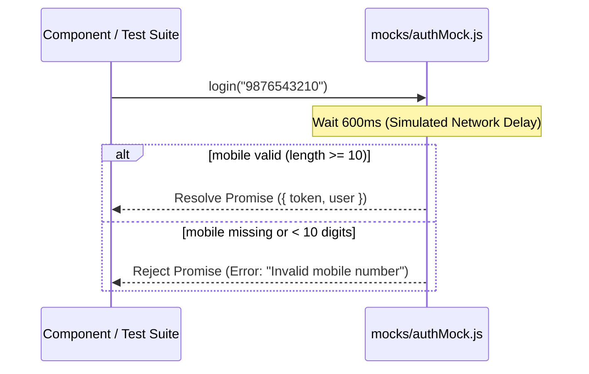

# authMock.js Documentation

## High-Level Overview
`authMock.js` provides a client-side mock implementation of authentication workflows for offline frontend development, testing, and UI prototyping. It simulates backend network latency using `setTimeout` wrapped inside a JavaScript Promise and enforces basic validation rules before returning synthetic JWT credentials and user profiles.

## Interface Breakdown

| Function | Type | Parameters | Return Type | Description |
| :--- | :--- | :--- | :--- | :--- |
| `login` | Async Function | `mobile: string` | `Promise<Object>` | Simulates authentication delay and resolves with a mock session token and profile. |

### Mock Response Structure

| Property | Type | Example Value | Description |
| :--- | :--- | :--- | :--- |
| `token` | `string` | `"mock-token"` | Synthetic authentication token for local session verification. |
| `user` | `Object` | `{ id: "1", name: "Shreya", mobile, language: "English" }` | Hardcoded user persona returned upon validation. |

## Architecture & Flow

## Dependencies & Environment

| Dependency | Type | Purpose |
| :--- | :--- | :--- |
| None | N/A | Pure JavaScript implementation running natively in standard browser environments. |

## Security & Limitations
- **Password Ignored:** The mock function signature accepts only `mobile` and does not accept or validate password inputs.
- **Static Hardcoded Persona:** Always returns a static profile named `"Shreya"` with `language: "English"`, limiting dynamic multi-user or localization testing scenarios.
