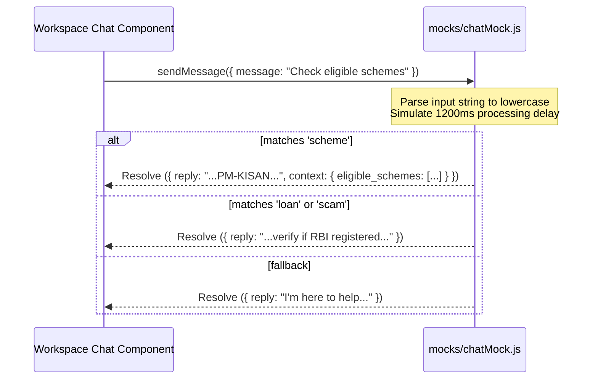

# chatMock.js Documentation

## High-Level Overview
`chatMock.js` simulates the interactive conversational responses and dynamic financial context engine of the ArthaNetra AI assistant. Designed for local development and testing without live AI backend dependencies, it parses user prompt keywords (e.g., loan, budget, scheme, health score) and returns contextually tailored advice alongside financial health metrics and scheme recommendations after a 1.2-second artificial network latency.

## Interface Breakdown

| Function | Type | Parameters | Return Type | Description |
| :--- | :--- | :--- | :--- | :--- |
| `sendMessage` | Async Function | `payload: { message: string }` | `Promise<Object>` | Analyzes user input keywords and resolves with simulated AI reply and financial context. |

### Keyword Dispatch Rules

| Keyword Match | Simulated AI Reply | Context Modifications |
| :--- | :--- | :--- |
| `loan` or `scam` | Warnings regarding risky loans and verifying RBI lender registration. | Default context maintained. |
| `budget` or `save` | Prompt to create a monthly budget by sharing income. | Default context maintained. |
| `scheme` | Recommends PM-KISAN and PM Jan Dhan Yojana. | `eligible_schemes` updated to `["PM-KISAN", "PM Jan Dhan Yojana"]`. |
| `health score` | Explains current Financial Health Score of 72. | Default context maintained. |
| Default (Fallback) | `"I'm here to help you with your financial questions."` | Default context maintained. |

### Context State Payload

| Field | Type | Default Value | Description |
| :--- | :--- | :--- | :--- |
| `financial_health_score` | `number` | `72` | Synthetic credit/financial wellness indicator. |
| `persona` | `string` | `"Student"` | Target user financial classification. |
| `income_type` | `string` | `"Student"` | Categorized income profile. |
| `language` | `string` | `"English"` | Active interaction language. |
| `goal` | `string` | `"Increase Savings"` | Primary financial objective. |
| `eligible_schemes` | `string[]` | `["PM Scholarship"]` | Array of recommended government assistance programs. |

## Architecture & Flow

## Dependencies & Environment

| Dependency | Type | Purpose |
| :--- | :--- | :--- |
| None | N/A | Self-contained mock utility relying solely on standard ECMAScript Promises and timers. |

## Security & Limitations
- **Case Sensitivity & Exact String Parsing:** Uses basic `.includes()` substring matching on lowercase text; complex natural language queries without exact keyword matches fall back to generic responses.
- **Stateless Simulation:** Does not persist conversation history across consecutive message calls; context resets to the default student profile on every invocation.
