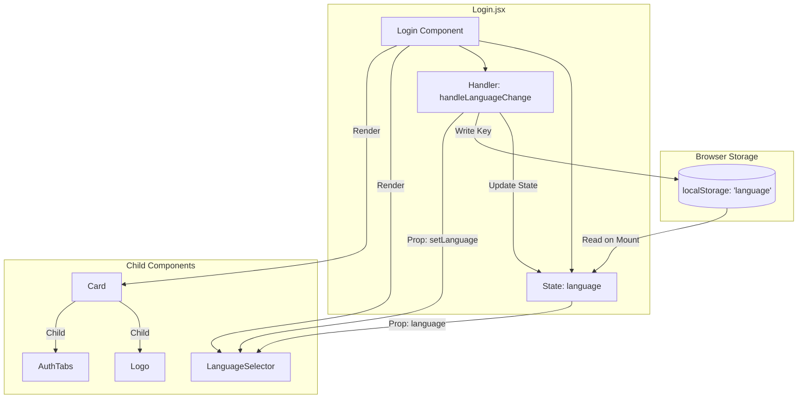

# Login Component Documentation

## High-Level Overview

The `Login` component (`Login.jsx`) serves as the primary authentication and user onboarding entry point for the **ArthaNetra AI** frontend application. Its core purpose is to provide an immersive, responsive, and multilingual interface where users can access their financial intelligence dashboard.

### Core Purpose & Business Logic
* **Multilingual Onboarding:** Initializes and manages the user's selected interface language (`language`), syncing selections with browser `localStorage` so user preferences persist across browser sessions.
* **Authentication Container:** Acts as a wrapper and layout host for the `AuthTabs` component, which encapsulates the granular login, registration, and OTP authentication flows.
* **Brand & Visual Identity:** Establishes a premium financial AI aesthetic using glassmorphism (`backdrop-blur-md`), dynamic animated gradient glow spheres, status indicators ("AI Financial Eye"), and trust badges ("256-Bit Secure", "Fast OTP", "Multilingual").

---

## Interface Breakdown

### Component Signature & Return Type
* **Component Name:** `Login`
* **Props:** None
* **Return Type:** `JSX.Element`

### State Management & Internal Handlers

| Identifier | Type | Initial Value | Description |
| :--- | :--- | :--- | :--- |
| `language` | `string` (`useState`) | `localStorage.getItem("language") \|\| "English"` | Tracks the currently active display language selected by the user. Defaults to persisted value or `"English"`. |
| `handleLanguageChange` | `(newLang: string) => void` | N/A | Updates local `language` state and writes `newLang` to `localStorage` under the `"language"` key. |

### Child Components & Prop Mappings

| Component | Import Source | Props Passed | Role / Responsibility |
| :--- | :--- | :--- | :--- |
| `LanguageSelector` | `../components/chat/LanguageSelector` | `language={language}`, `setLanguage={handleLanguageChange}` | Dropdown or toggle interface allowing real-time switching of the active UI language. |
| `Logo` | `../components/shared/Logo` | `className="text-3xl sm:text-4xl justify-center mb-3"` | Renders the ArthaNetra AI brand icon and gradient typography. |
| `Card` | `../components/shared/Card` | `className="!p-6 sm:!p-8 lg:!p-10 shadow-2xl shadow-black/40 border-white/20"` | Glassmorphic container wrapper providing padding, borders, and depth for the authentication forms. |
| `AuthTabs` | `../components/auth/AuthTabs` | `defaultTab="login"` | Displays tabbed navigation for user sign-in and registration workflows. |

---

## Architecture & Flow

### Component Hierarchy & Data Flow Diagram

---

## Dependencies & Environment

### External & Internal Dependencies

| Dependency | Type | Purpose |
| :--- | :--- | :--- |
| `react` (`useState`) | Core Library | Manages component-level state for language preference tracking. |
| `LanguageSelector` | Internal Component | Renders language selector interface. |
| `Logo` | Internal Component | Displays ArthaNetra branding. |
| `Card` | Internal Shared Component | Provides standard UI card wrapper with custom Tailwind overrides. |
| `AuthTabs` | Internal Component | Handles authentication sub-views (Login/Register tabs). |

### Environment Variables & Storage Interactions
* **Environment Variables:** None required directly by `Login.jsx`.
* **Storage API:**
  * Read: `localStorage.getItem("language")` during state initialization.
  * Write: `localStorage.setItem("language", newLang)` executed whenever language selection changes.

---

## Security & Limitations

### Security Considerations
* **Static Trust Badges:** The UI displays `🔒 256-Bit Secure` and `⚡ Fast OTP`, but actual cryptographic protocols and OTP verification are handled downstream inside `AuthTabs` and backend endpoints.
* **No Sensitive Storage:** Only the language preference (`"language"`) is stored in unencrypted `localStorage`. No credentials or tokens are manipulated directly within `Login.jsx`.

### Limitations & Edge Cases
* **Unhandled LocalStorage Exceptions:** Accessing `window.localStorage` inside `useState` initialization without a `try/catch` block can throw synchronous security exceptions in restricted browser environments (e.g., Safari Private Browsing with strict tracking prevention or iframe sandboxing), potentially causing a render crash.
* **Hardcoded Fallback:** The language fallback is hardcoded to `"English"` rather than detecting browser locale (`navigator.language`).
