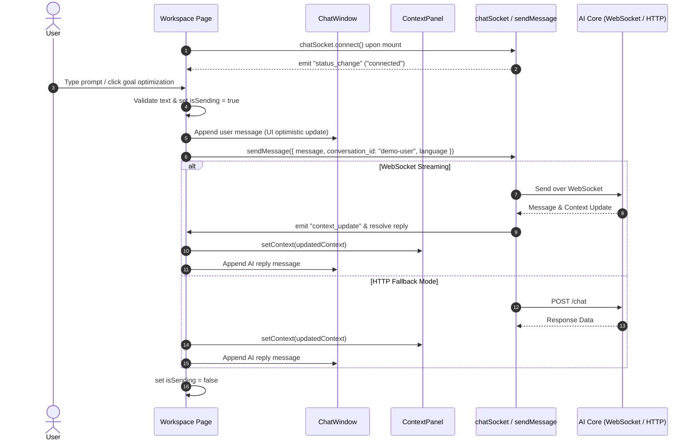

# Workspace Component Documentation

## High-Level Overview

The `Workspace` component (`Workspace.jsx`) serves as the core financial intelligence console and conversational interface for **ArthaNetra AI**. It provides an interactive dual-pane dashboard where users can query financial advice, analyze budgets, explore government schemes, and monitor their live financial health score via real-time **WebSocket streaming telemetry** with seamless HTTP fallback.

### Core Purpose & Business Logic
* **Real-Time WebSocket & AI Orchestration:** Connects to the persistent `chatSocket` service upon mounting, maintaining bidirectional communication with the ArthaNetra AI engine. Tracks real-time connection status (`connectionStatus`), dispatches queries (`sendMessage`), and renders responsive status badges across header and chat console.
* **Dynamic Context Synchronization:** Tracks and updates user financial metadata (`context`), including financial health scores, user personas, income profiles, target financial goals, and eligible government schemes. Listens to spontaneous WebSocket `"context_update"` events and updates sidebar metrics immediately.
* **Interactive Context Actions:** Connects GoalCard optimization actions in the ContextPanel directly to `handleSendPrompt`, enabling users to trigger AI financial goal advice with a single click.
* **Multilingual Session Control:** Syncs user language preferences with browser `localStorage` and propagates language changes to both the AI backend and UI components. Also allows instant conversation resets (`handleResetSession`).

---

## Interface Breakdown

### State Management & Internal Handlers

| Identifier | Type | Initial Value | Description |
| :--- | :--- | :--- | :--- |
| `messages` | `Array<Object>` (`useState`) | `[{ id: 1, sender: "assistant", text: "..." }]` | Array of message objects representing the chat transcript. |
| `context` | `Object` (`useState`) | `{ financial_health_score: 72, persona: "Student", ... }` | Live user financial profile and intelligence metrics displayed in the sidebar. |
| `language` | `string` (`useState`) | `localStorage.getItem("language") \|\| "English"` | Current display and AI response language. |
| `isSending` | `boolean` (`useState`) | `false` | Indicates whether an asynchronous prompt request to the AI service is currently pending. |
| `connectionStatus` | `string` (`useState`) | `chatSocket.status` | Tracks WebSocket stream state (`"connected"`, `"connecting"`, `"disconnected"`). |
| `handleLanguageChange` | `(newLang: string) => void` | N/A | Updates local language state, persists to `localStorage`, and updates language in `context`. |
| `handleResetSession` | `() => void` | N/A | Clears existing chat messages and initializes a fresh onboarding message in the active language. |
| `handleSendPrompt` | `async (text: string) => Promise<void>` | N/A | Dispatches prompt via WebSocket (`sendMessage`), appends user/assistant turns, and updates context. |

### Child Components & Prop Mappings

| Component | Import Source | Props Passed | Role / Responsibility |
| :--- | :--- | :--- | :--- |
| `Logo` | `../components/shared/Logo` | `className="text-xl sm:text-2xl"` | Renders brand branding inside the sticky header. |
| `LanguageSelector` | `../components/chat/LanguageSelector` | `language={language}`, `setLanguage={handleLanguageChange}` | Header dropdown for real-time multilingual switching. |
| `ChatWindow` | `../components/chat/ChatWindow` | `messages={messages}`, `isSending={isSending}`, `connectionStatus={connectionStatus}` | Scrollable transcript console displaying user inquiries, AI responses, and connection status banners. |
| `SuggestedPrompts` | `../components/chat/SuggestedPrompts` | `onPromptClick={handleSendPrompt}` | Displays clickable prompt pills that trigger instant inquiries. |
| `ChatInput` | `../components/chat/ChatInput` | `messages`, `setMessages`, `setContext`, `language`, `onSendExternal={handleSendPrompt}`, `connectionStatus={connectionStatus}` | Bottom text console for user text submission and voice/attachment interactions. |
| `ContextPanel` | `../components/context/ContextPanel` | `context={context}`, `connectionStatus={connectionStatus}`, `onGoalClick={handleSendPrompt}` | Right-hand live sidebar displaying financial health analytics, goals, and eligible schemes. |

---

## Architecture & Flow

### Request Pipeline & Real-Time Data Sync Diagram

