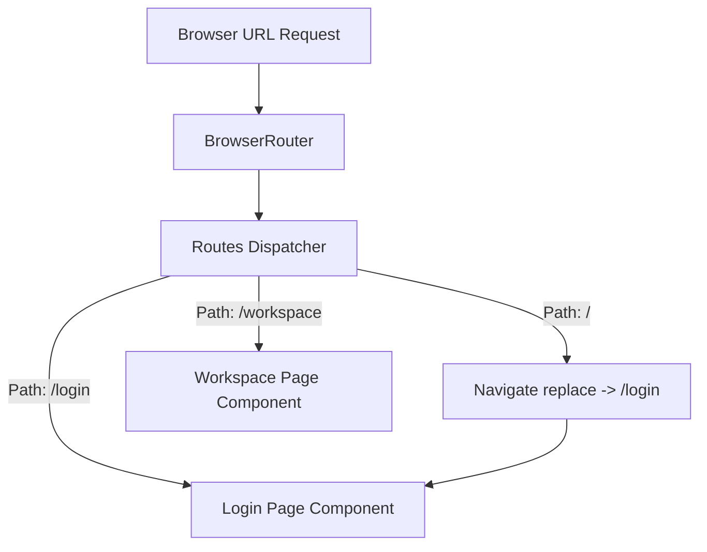

# AppRoutes.jsx Documentation

## High-Level Overview
`AppRoutes.jsx` manages the declarative client-side routing hierarchy for the ArthaNetra AI frontend using `react-router-dom`. It establishes a `BrowserRouter` wrapper and maps URL paths to specific page components (`Login` and `Workspace`). It also configures automatic redirection from the root path (`/`) to `/login`.

## Interface Breakdown

| Component / Function | Type | Props / Parameters | Return Type | Description |
| :--- | :--- | :--- | :--- | :--- |
| `AppRoutes` | Functional React Component | None | `JSX.Element` | Renders the complete routing tree inside a `BrowserRouter`. |

### Route Specifications

| Path | Element Rendered | Behavior / Notes |
| :--- | :--- | :--- |
| `/` | `<Navigate to="/login" replace />` | Redirects landing requests directly to the login screen, replacing history stack entry. |
| `/login` | `<Login />` | Renders user authentication and onboarding view. |
| `/workspace` | `<Workspace />` | Renders the interactive ArthaNetra AI workspace interface. |

## Architecture & Flow

## Dependencies & Environment

| Dependency | Type | Purpose |
| :--- | :--- | :--- |
| `react-router-dom` | External Package | Provides `BrowserRouter`, `Routes`, `Route`, and `Navigate` components for routing. |
| `../pages/Login` | Internal Component | Page component handling user authentication. |
| `../pages/Workspace` | Internal Component | Page component providing AI assistant chat and financial dashboard capabilities. |

## Security & Limitations
- **Unprotected Protected Routes:** Currently, `/workspace` does not enforce route-level authentication guards (such as checking `AuthContext` before rendering). Unauthenticated users can navigate directly to `/workspace` via the browser address bar unless protected within `Workspace.jsx`.
- **404 Fallback Missing:** There is no catch-all route (`*`) configured. Navigating to unlisted routes (e.g., `/unknown`) results in a blank rendered area.
