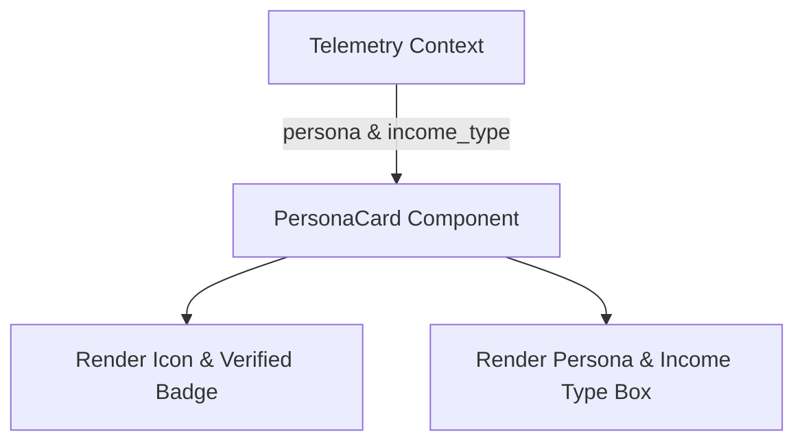

# PersonaCard Component Documentation

## High-Level Overview
The `PersonaCard` component displays the active demographic profile and income classification assigned to the current user by ArthaNetra AI's inference engine. Its core purpose is to verify user identity attributes (such as occupation or socioeconomic segment) and show the corresponding income profile used to customize conversational advice.

Within the Context Panel sidebar, it provides visual reassurance that user profiles are verified while highlighting their specific income profile or demographic classification.

## Interface Breakdown

### Component Props
| Prop Name | Type | Required | Default | Description |
| :--- | :--- | :--- | :--- | :--- |
| `userName` | `string` | Optional | `undefined` | The user's display name rendered prominently in the card header. |
| `persona` | `string` | Optional | `"Student"` | The categorical classification assigned to the user profile (e.g., `"Student"`, `"Farmer"`, `"MSME Owner"`). |
| `incomeType` | `string` | Optional | `"Variable"` | The user's income classification or profile type (e.g., `"Variable"`, `"Salaried"`). |
| `onEditProfile` | `function` | Optional | `undefined` | Click handler triggered when clicking the card to launch the profile pop-up menu. |

### Visual Layout Sections
| Section | Elements Displayed | Styling Theme |
| :--- | :--- | :--- |
| **Card Header** | User Avatar circle with initials, user display name (`userName`), Edit icon (`FiEdit3`), and `"Verified"` shield badge (`FiShield`). | Purple & Indigo accent colors with hover glow. |
| **Profile Display** | Assigned persona string (`persona`). | Bold white typography (`text-sm font-bold`). |
| **Income Indicator** | Dynamic income type classification (`incomeType`). | Purple highlight (`text-purple-300`). |

## Architecture & Flow

## Dependencies & Environment

### External Packages
- **`react-icons/fi`**: Uses Feather icons (`FiUserCheck`, `FiShield`) for identity verification cues.
- **Tailwind CSS**: Leverages translucent backgrounds (`bg-slate-800/60`), border styling, and hover brightening effects (`hover:bg-slate-800/80`).
