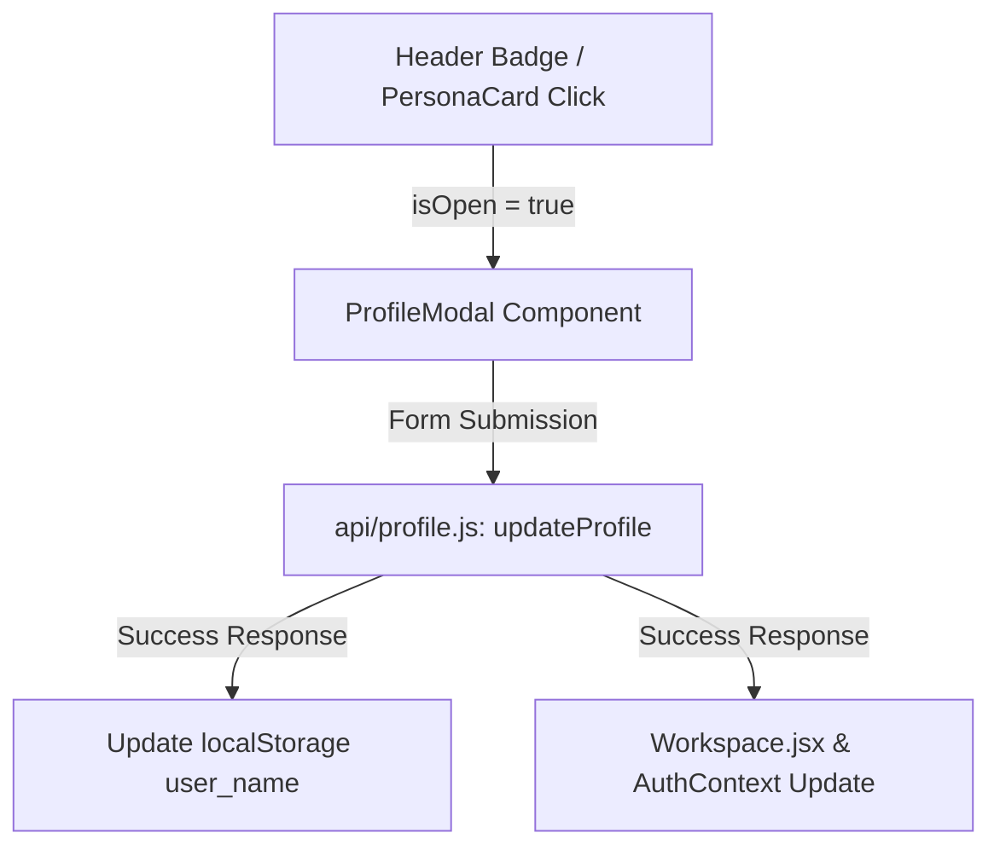

# ProfileModal Component Documentation

## High-Level Overview
The `ProfileModal` component provides an interactive pop-up dialog interface allowing authenticated users to view and update their display name, demographic occupation (`persona`), income structure (`income_type`), and primary financial goal (`goal`). 

When users click on the user profile badge in the navigation header or the `PersonaCard` inside the live telemetry sidebar, this modal opens. Submitting the form synchronizes the user's updated profile with backend storage via `updateProfile` and adapts real-time AI advisory context immediately.

## Interface Breakdown

### Component Props
| Prop Name | Type | Required | Default | Description |
| :--- | :--- | :--- | :--- | :--- |
| `isOpen` | `boolean` | Required | `false` | Controls visibility of the modal dialog overlay. |
| `onClose` | `function` | Required | `undefined` | Callback invoked when the modal backdrop or close button is clicked. |
| `user` | `Object` | Optional | `null` | Current authenticated user object from `AuthContext`. |
| `context` | `Object` | Optional | `{}` | Current live AI telemetry context state. |
| `onSave` | `function` | Optional | `undefined` | Callback invoked with updated profile payload upon successful API save. |

### Visual & Interactive Fields
| Field Section | Selection Options | Customization Support |
| :--- | :--- | :--- |
| **Display Name** | Text input displaying current user name. | Free-text input (`name`). |
| **Occupation / Persona** | Predefined badges (`Salaried Professional`, `Student / Scholar`, `Business / Entrepreneur`, `Freelancer / Gig Worker`, etc.). | Custom text input (`customPersona`). |
| **Income Structure** | Predefined badges (`Regular Monthly`, `Variable / Seasonal`, `Business Revenue`, etc.). | Custom text input (`customIncome`). |
| **Financial Goal** | Predefined badges (`Budget Optimization`, `Emergency Fund`, `Wealth Accumulation`, etc.). | Custom text input (`customGoal`). |

## Architecture & Flow

## Dependencies & Environment

### External Packages & Modules
- **`react-icons/fi`**: Icons for clean section visual structure (`FiUserCheck`, `FiBriefcase`, `FiDollarSign`, `FiTarget`, `FiX`, `FiCheckCircle`).
- **`../../api/profile`**: Imports `updateProfile` for making HTTP PUT requests to persist user profile modifications.
